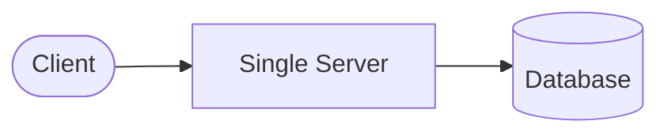
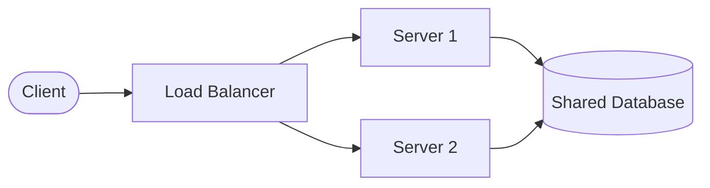
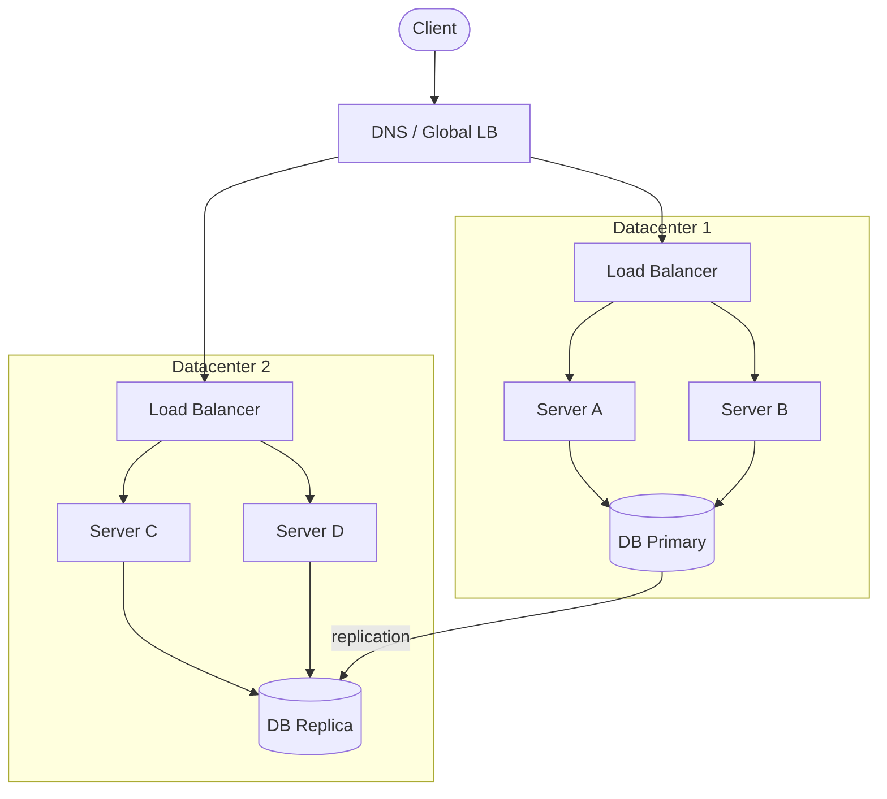
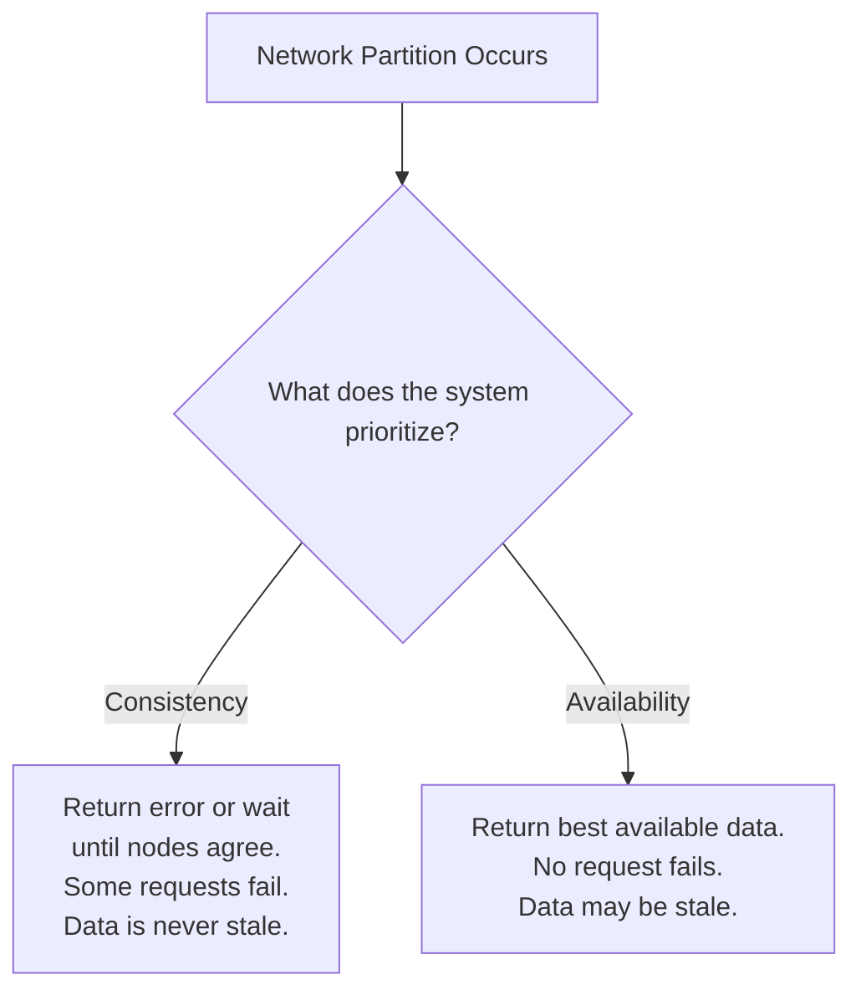
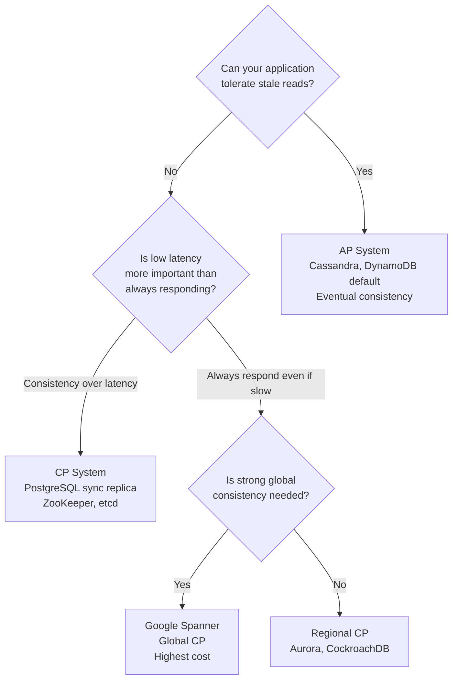

## TL;DR

- A distributed system is multiple computers coordinating to look like one system. Failures, latency, and inconsistency make this fundamentally hard.
- CAP theorem forces a choice: when a network partition happens, your system must sacrifice either consistency or availability.
- Designing for failure is not optional. Nodes crash, networks partition, and latency spikes. Your system must handle all three gracefully.

---

## The Problem

It is 2:47 AM. Your on-call phone rings. The payment service is down. Every request is timing out. Users are seeing errors. You SSH into the server and find the process has crashed: it was out of memory. You restart it. It comes back up. Incident resolved in four minutes.

Three months later, 2:47 AM again. Same alert, same payment service. This time you SSH in and the server is unreachable. The machine itself has failed from a hardware fault. You have no backup. The service stays down until a new VM is provisioned, the app is deployed, and the database connection is re-established. That takes 47 minutes.

You make a decision: deploy a second server. Now you have two copies running behind a load balancer. If one crashes, the other handles traffic. The 47-minute outage becomes a 30-second blip.

Then you deploy a third server in a different datacenter. And a fourth. And now you have a distributed system, along with a completely different category of problems. The two-server solution was simple. The four-server, two-datacenter solution requires you to answer questions you never had to think about before:

- What happens if the network between your datacenters fails? Both halves of your system are running but cannot talk to each other.
- If a user updates their profile on server A, will server B immediately know about it?
- If two servers both try to process the same payment at the same time, what prevents a double charge?
- How do you know which servers are healthy if the health check network itself is unreliable?

These are the questions distributed systems engineering is built around. This chapter gives you the foundation to answer all of them.

---

## What This Post Covers

- What is a Distributed System?
- Scaling: Vertical vs Horizontal
- Stateless vs Stateful Services
- Core Properties: Availability, Reliability, Durability, Robustness
- The Hard Problems: Failures, Partitions, Latency
- CAP Theorem
- PACELC Theorem
- High Availability and Fault Tolerance
- Single Points of Failure and Bottlenecks

---

## Mental Model

Think of a distributed system like a restaurant chain. A single restaurant can serve customers, but it has limits: one kitchen, one team, one location. If the kitchen catches fire, the whole restaurant closes.

A chain of restaurants solves those limits. Customers near a closed branch go to the next one. The chain keeps serving even when individual locations fail.

But coordinating a chain is nothing like running one restaurant. How do you keep the menu consistent across all locations? If a new item is added at headquarters, every branch needs to know, but it takes time to distribute the update. During that time, some branches have the new item and some do not. A customer who visits two branches on the same day might see different menus.

This is exactly what happens in distributed systems. Multiple nodes (the branches) collectively serve users (the customers), but keeping every node consistent, up to date, and in sync is the central engineering challenge.

The analogy breaks down when you imagine a restaurant chain where the communication between locations can fail completely, randomly, at any time, with no warning. Real distributed systems deal with network partitions (the communication lines between nodes going silent) where no restaurant chain ever has to assume its headquarters might become permanently unreachable on a random Tuesday night.

---

## How It Works

### Step 1: One Server

Start here. One machine, one process, one database.



This is simple. Requests come in, the server processes them, the database persists state. When the server crashes, everything stops. When the database runs out of disk, everything stops. This machine is both a bottleneck (it handles all load) and a single point of failure (SPOF, meaning one component whose failure takes down the entire system).

### Step 2: Two Servers, One Database

Add a second server behind a load balancer (a component that distributes incoming requests across multiple servers).



Now one server can crash and traffic routes to the other. But notice: the database is still a single point of failure. The load balancer is too.

### Step 3: N Servers, Replicated Database, Multiple Datacenters

The production picture. Servers in multiple availability zones. Database replicated across machines. Load balancers themselves redundant.



Now each layer introduces new failure modes. What happens if the replication link between DB Primary and DB Replica goes down? The replica falls behind. Reads from DC2 may return stale data. This is the distributed systems problem in its purest form.

### Vertical vs Horizontal Scaling

**Vertical scaling** (scaling up): replace the server with a bigger one. More CPU, more RAM, faster disk. This is simple, with no code changes needed. But it has a hard ceiling. The largest available machine is the limit. It is also still a single point of failure.

**Horizontal scaling** (scaling out): add more servers. No hard ceiling. Keep adding nodes. But now you have a distributed system and all the problems that come with it.

The engineering rule: start vertical, switch horizontal when you hit the ceiling or when you need fault tolerance that vertical cannot provide.

### Stateless vs Stateful Services

A **stateless service** holds no memory of past requests. Every request carries all the information needed to process it. Any server can handle any request. Scaling out is as simple as adding more servers.

A **stateful service** holds session data, caches, or other state in memory. A request from the same user must go to the same server (called session stickiness). Scaling out is harder because state cannot be freely redistributed.

```go
// Stateless handler: no server-side state.
// Any server can process any request, so scale horizontally without coordination.
func handleGetUser(w http.ResponseWriter, r *http.Request) {
    userID := r.URL.Query().Get("id")
    // All state lives in the database, not in this process.
    user, err := db.GetUser(r.Context(), userID)
    if err != nil {
        http.Error(w, "user not found", http.StatusNotFound)
        return
    }
    json.NewEncoder(w).Encode(user)
}

// Stateful handler: in-memory session cache.
// If this server restarts, all sessions are lost.
// If you add a second server, sessions from server 1 are invisible to server 2.
var sessions = map[string]Session{} // BAD: in-process state

func handleGetSession(w http.ResponseWriter, r *http.Request) {
    token := r.Header.Get("Authorization")
    session, ok := sessions[token]
    if !ok {
        http.Error(w, "session not found", http.StatusUnauthorized)
        return
    }
    json.NewEncoder(w).Encode(session)
}
```

The fix for stateful services: externalize the state. Move sessions to Redis. Move files to object storage. The service process becomes stateless; the external store holds the state.

### The Core Properties

Every distributed system is designed around four properties. These are not optional. They are the vocabulary of every architectural decision you will make.

**Availability** means the system responds to every request, even during partial failures. If two out of ten servers crash, the remaining eight keep serving. Availability is measured as a percentage: 99.9% availability means the system can be down for at most 8.76 hours per year.

**Reliability** means the system consistently does the correct thing over time. A system can be available (always responding) but unreliable (sometimes giving wrong answers). A payment system that processes transactions but occasionally double-charges is available but not reliable.

**Durability** means data once written survives crashes, restarts, and hardware failures. A database that acknowledges a write and then loses it on disk failure has violated durability.

**Robustness** means the system degrades gracefully under unexpected conditions rather than failing catastrophically. A robust system under overload sheds the least important traffic (rate limiting lower-priority requests) instead of collapsing entirely.

### The Hard Problems

Three things make distributed systems hard, in every real deployment:

**Partial failures.** In a single-process system, the process either runs or crashes. In a distributed system, some components fail while others keep running. Server B is healthy; server C is down; the network between A and B is slow; the database in DC2 is two seconds behind the one in DC1. Your system must continue operating correctly in this mixed state.

**Network partitions.** A partition is when a network failure splits your nodes into groups that cannot communicate with each other. Both groups keep running, but they cannot coordinate. The left group thinks the right group is dead. The right group thinks the left group is dead. Both may start making decisions that contradict each other.

**Latency and throughput.** Latency is the time to complete one operation. Throughput is the number of operations completed per unit of time. In a single-server system these are simple to reason about. In a distributed system, every network hop adds latency, and the slowest node limits your effective throughput. These are not interchangeable: you can have high throughput with high latency (batch processing) or low latency with low throughput (a single fast request handler).

---

## Go Implementation

### Demonstrating Availability vs Reliability

```go
// availability_vs_reliability.go
// Run with: go run availability_vs_reliability.go  (requires Go 1.22+)
package main

import (
	"fmt"
	"math/rand"
)

type Response struct {
	Value   int
	IsError bool
}

// availableButUnreliable: always responds (available) but sometimes gives wrong answers.
// This models a replica that serves stale reads without checking replication lag.
func availableButUnreliable(trueValue int) Response {
	if rand.Float64() < 0.3 {
		// 30% of the time, return a stale value: wrong, but not an error.
		return Response{Value: trueValue - 1, IsError: false}
	}
	return Response{Value: trueValue, IsError: false}
}

// reliableButSometimesUnavailable: always correct when it responds, but refuses
// to respond when it cannot guarantee correctness.
// This models a system that returns an error rather than serve stale data.
func reliableButSometimesUnavailable(trueValue int) Response {
	if rand.Float64() < 0.3 {
		// 30% of the time, cannot confirm the value is fresh, so refuse to serve.
		return Response{IsError: true}
	}
	return Response{Value: trueValue, IsError: false}
}

func main() {
	trueValue := 42
	requests := 10

	fmt.Println("=== Available but unreliable (like an eventually-consistent replica) ===")
	for i := range requests {
		resp := availableButUnreliable(trueValue)
		if resp.Value != trueValue {
			fmt.Printf("Request %d: got %d (WRONG, but no error returned)\n", i+1, resp.Value)
		} else {
			fmt.Printf("Request %d: got %d (correct)\n", i+1, resp.Value)
		}
	}

	fmt.Println("\n=== Reliable but sometimes unavailable (like a strongly-consistent replica) ===")
	for i := range requests {
		resp := reliableButSometimesUnavailable(trueValue)
		if resp.IsError {
			fmt.Printf("Request %d: ERROR (unavailable, but never wrong)\n", i+1)
		} else {
			fmt.Printf("Request %d: got %d (correct)\n", i+1, resp.Value)
		}
	}
}

// Output (varies by run; math/rand auto-seeds in Go 1.20+):
// === Available but unreliable ===
// Request 1: got 42 (correct)
// Request 2: got 41 (WRONG, but no error returned)
// ...
// === Reliable but sometimes unavailable ===
// Request 1: got 42 (correct)
// Request 2: ERROR (unavailable, but never wrong)
// ...
```

This is not a theoretical distinction. It is the core trade-off every database replication strategy makes. Read replicas in PostgreSQL are available but can serve stale reads. Synchronous replication is reliable but blocks if the replica is slow.

### Detecting a Single Point of Failure

```go
// spof_detector.go
// Run with: go run spof_detector.go
package main

import (
	"fmt"
	"sync"
	"time"
)

type Component struct {
	Name      string
	IsHealthy bool
}

// SystemHealthCheck checks all components and reports whether any single failure
// would take the entire system down (a SPOF).
func SystemHealthCheck(components []Component) {
	var mu sync.Mutex
	failed := []string{}

	var wg sync.WaitGroup
	for _, c := range components {
		wg.Add(1)
		go func(comp Component) {
			defer wg.Done()
			// Simulate checking the component.
			time.Sleep(10 * time.Millisecond)
			if !comp.IsHealthy {
				mu.Lock()
				failed = append(failed, comp.Name)
				mu.Unlock()
			}
		}(c)
	}
	wg.Wait()

	if len(failed) == 0 {
		fmt.Println("All components healthy.")
		return
	}
	for _, name := range failed {
		fmt.Printf("SPOF RISK: %q is down. If it has no redundancy, the system is degraded.\n", name)
	}
}

func main() {
	components := []Component{
		{Name: "Load Balancer",    IsHealthy: true},
		{Name: "Server A",         IsHealthy: true},
		{Name: "Server B",         IsHealthy: false}, // simulated failure
		{Name: "Database Primary", IsHealthy: true},
		{Name: "Database Replica", IsHealthy: true},
	}

	SystemHealthCheck(components)
}

// Output:
// SPOF RISK: "Server B" is down. If it has no redundancy, the system is degraded.
```

At a scale of two servers, losing one means 50% of capacity is gone but the system keeps running. At a scale of one server, losing it means 100% capacity is gone and the system is down. Redundancy is the elimination of SPOFs.

---

## CAP Theorem

CAP theorem (proposed by Eric Brewer in 2000, proved by Gilbert and Lynch in 2002) states that a distributed system can guarantee at most two of three properties simultaneously:

**Consistency (C):** every read returns the most recent write, or an error. All nodes see the same data at the same time.

**Availability (A):** every request receives a response (not an error), though that response may contain stale data.

**Partition tolerance (P):** the system continues operating when network partitions occur (when nodes cannot communicate with each other).

The key insight is that partition tolerance is not optional in any real distributed system. Networks fail. You cannot build a distributed system that assumes the network is always reliable. So the real trade-off is: when a partition happens, do you choose consistency or availability?



**CP systems** (Consistency + Partition tolerance): HBase, ZooKeeper, etcd. When a partition happens, they refuse to serve requests they cannot answer consistently. You get an error, not a stale response.

**AP systems** (Availability + Partition tolerance): Cassandra, DynamoDB (by default), CouchDB. When a partition happens, they serve the best data they have. You get a response, but it may be stale.

No real system is purely CP or purely AP. They offer configuration options. DynamoDB can be configured for strong consistency. Cassandra's consistency level is tunable per query.

### PACELC: The Full Picture

CAP only describes behavior during partitions. PACELC (proposed by Daniel Abadi in 2012) extends it to describe the trade-off that exists even when the system is running normally:

**During a Partition: choose between Availability and Consistency.**
**Else (no partition): choose between Latency and Consistency.**

Even when no partition is happening, strong consistency costs latency. To ensure every node agrees on a write before acknowledging it, you must wait for all nodes to confirm. That wait is latency. Eventually consistent systems skip that wait: they acknowledge the write immediately and replicate in the background, which is faster but means reads may see stale data temporarily.

| System | Partition behavior | Normal behavior |
|--------|-------------------|-----------------|
| DynamoDB (default) | AP: serves stale data | EL: low latency, eventual consistency |
| DynamoDB (strong reads) | CP: returns error | CL: higher latency, strong consistency |
| PostgreSQL synchronous replica | CP | CL |
| Cassandra (QUORUM) | CP | CL |
| Cassandra (ONE) | AP | EL |

---

## Real System Examples

**AWS Aurora MySQL** illustrates the partition/availability trade-off in practice. Aurora writes to a quorum (majority) of its six storage nodes across three availability zones before acknowledging a write. If fewer than four nodes are reachable, Aurora stops accepting writes rather than risk data loss. This is a CP choice for writes. Reads from the reader endpoint can be served from replicas even if the writer is unavailable, which is an AP choice for reads. Aurora separates the consistency requirement for writes from the availability requirement for reads.

**Kafka** is designed for durability and availability over strong consistency. A producer can configure `acks=all` to require acknowledgment from all in-sync replicas before a write is confirmed, which is the CP choice. With `acks=1`, only the leader acknowledges, which is the AP choice. The default changed from `acks=1` to `acks=all` in Kafka 3.0 because production incidents caused by lost writes were more costly than the latency increase.

**Google Spanner** takes the CP route and achieves global strong consistency using TrueTime (covered in a later chapter on global clocks). It is slower than AP systems because every write must be globally confirmed, but it eliminates the class of bugs that come from stale reads in financial and inventory systems.

---

## What Can Go Wrong

### Failure Mode 1: Assuming the Network Is Reliable

```go
// BAD: no timeout. If the downstream service hangs, this goroutine hangs forever.
func fetchUserBad(userID string) (*User, error) {
	resp, err := http.Get("http://user-service/users/" + userID)
	if err != nil {
		return nil, err
	}
	defer resp.Body.Close()
	var user User
	json.NewDecoder(resp.Body).Decode(&user)
	return &user, nil
}

// CORRECT: context with deadline propagates through the call chain.
// If user-service takes more than 500ms, the call is cancelled.
func fetchUserCorrect(ctx context.Context, userID string) (*User, error) {
	callCtx, cancel := context.WithTimeout(ctx, 500*time.Millisecond)
	defer cancel()

	req, err := http.NewRequestWithContext(callCtx, http.MethodGet,
		"http://user-service/users/"+userID, nil)
	if err != nil {
		return nil, fmt.Errorf("build request: %w", err)
	}

	resp, err := http.DefaultClient.Do(req)
	if err != nil {
		return nil, fmt.Errorf("fetch user %s: %w", userID, err)
	}
	defer resp.Body.Close()

	var user User
	if err := json.NewDecoder(resp.Body).Decode(&user); err != nil {
		return nil, fmt.Errorf("decode user: %w", err)
	}
	return &user, nil
}

// Failure injection: simulate a slow downstream service.
// time.Sleep(2 * time.Second) // Uncomment inside the handler to observe the timeout.
```

Without a timeout, one slow downstream service can exhaust your goroutine pool and take down your entire service. This is how cascade failures start.

### Failure Mode 2: Ignoring Partial Failures

```go
// BAD: treats all errors the same. A timeout gets the same handling as a 404.
func processOrderBad(ctx context.Context, orderID string) error {
	_, err := fetchInventory(ctx, orderID)
	if err != nil {
		return fmt.Errorf("failed: %w", err) // retry? give up? we don't know.
	}
	return nil
}

// CORRECT: distinguish retryable errors (network timeouts) from permanent errors (not found).
func processOrderCorrect(ctx context.Context, orderID string) error {
	_, err := fetchInventory(ctx, orderID)
	if err == nil {
		return nil
	}
	if isRetryable(err) {
		// Network blip, safe to retry with backoff.
		return fmt.Errorf("transient error, retry: %w", err)
	}
	// Permanent error (404, 400). Retrying will not help.
	return fmt.Errorf("permanent error, do not retry: %w", err)
}

func isRetryable(err error) bool {
	// Timeouts and connection errors are retryable. 4xx responses are not.
	var netErr net.Error
	return errors.As(err, &netErr) && netErr.Timeout()
}
```

### Failure Mode 3: Treating Availability as Binary

A common mistake is to consider a service either "up" or "down." In reality, a service can be partially degraded: responding to 70% of requests in 50ms and to 30% in 8 seconds. That 30% tail is a distributed system failure that a simple health check will not catch.

The fix: measure P99 latency (the slowest 1% of requests), not just error rates. A service with 0% errors but P99 latency of 10 seconds is effectively unavailable for a significant portion of users.

---

## Trade-offs

| Approach | Strength | Weakness | Concrete Cost | Use When |
|----------|----------|----------|---------------|----------|
| Single server | Simple, no coordination | SPOF, vertical scaling ceiling | One hardware failure causes full outage | Prototypes, internal tools under low load |
| Multiple servers, shared DB | Fault tolerant for compute | DB is still a SPOF | Requires load balancer and session management | Most web services |
| Stateless services | Easy horizontal scaling | External state store required | Redis or DB for all session state | APIs, microservices |
| CP system (strong consistency) | Reads always correct | Higher latency, may reject requests during partition | +1-5ms per write for quorum, errors during partitions | Financial data, inventory, anything where staleness causes real harm |
| AP system (eventual consistency) | Always available, low latency | Reads may be stale | Stale reads require application-level conflict handling | Social feeds, analytics, caches, anything tolerating brief staleness |



---

## Common Misconceptions

**Misconception:** "Distributed systems are just multiple servers behind a load balancer."

**Reality:** A load balancer distributes traffic, but it does not make your system distributed in the meaningful sense. The hard part is what happens to your data, your state, and your consistency guarantees when nodes fail or cannot communicate. A load balancer with a single database behind it is not a distributed system: it is a horizontally scaled monolith. The distributed complexity begins when you replicate or shard the data layer.

---

**Misconception:** "CAP theorem means I have to pick two and lose one forever."

**Reality:** CAP describes the behavior during a network partition, which is a specific failure scenario. When your system is running normally (no partition), you can have all three. The choice is: when a partition *does* happen, which of C and A do you sacrifice? Most systems make this configurable. DynamoDB lets you choose per-read whether you want strong consistency (CP) or eventual consistency (AP).

---

**Misconception:** "Eventual consistency means stale data for a few milliseconds."

**Reality:** Eventual consistency gives no time bound. Under a network partition, two replicas could diverge indefinitely. "Eventually" means "when the partition heals," which could be seconds, minutes, or never if the partition is permanent. In practice, most eventually consistent systems converge in milliseconds to seconds under normal conditions, but this is an operational characteristic, not a guarantee the consistency model provides.

---

## Interview Questions

**Q: What happens when a server goes down in a distributed system?**

A model answer: It depends on whether the system was designed for fault tolerance. If that server holds state that no other server has, users who depended on it see errors or data loss. If the system is stateless and horizontally scaled, the load balancer routes around the failed server within seconds (usually one to three health check intervals). The important design decision is whether your system has a single point of failure, meaning any component whose failure takes down the whole system. Good distributed system design eliminates SPOFs by having at least two of everything critical, with automatic failover.

---

**Q: Why are distributed systems difficult?**

A model answer: Three reasons. First, partial failures: unlike a single process that is either running or not, distributed systems can have some components healthy and others failed simultaneously, and the system must behave correctly in that mixed state. Second, network unreliability: network calls can be slow, can fail, or can succeed in ways you cannot observe (a write might reach the server but the acknowledgment might not come back). Third, the lack of a global clock: you cannot determine the true order of events across machines without careful coordination, which makes reasoning about consistency and causality genuinely hard.

---

**Q: Explain CAP theorem with practical examples.**

A model answer: CAP says a distributed system can guarantee at most two of: Consistency (every read returns the latest write), Availability (every request gets a response), and Partition Tolerance (the system works even when nodes cannot talk to each other). Since network partitions happen in real systems, the real choice is C versus A during a partition. ZooKeeper and etcd choose CP: during a partition, they stop serving requests rather than risk returning inconsistent data. Cassandra and DynamoDB default to AP: during a partition, they keep serving requests but may return stale data. Neither choice is universally better; it depends on what failure mode your application can tolerate.

---

**Q: How do you design a highly available service?**

A model answer: High availability requires eliminating every single point of failure across all layers. That means multiple servers behind a load balancer, the load balancer itself redundant, the database replicated across machines and ideally across availability zones, with automatic failover. You also need health checks with fast failure detection, circuit breakers to prevent cascade failures, and graceful degradation so a failed component causes a partial outage rather than a total one. Finally, you measure availability as a real number (what percentage of requests succeed) rather than as a binary up/down status.

---

**Q: What is the difference between availability and reliability?**

A model answer: Availability is about responding to requests: the system is available if it answers. Reliability is about correctness: the system is reliable if it answers correctly. A system can be highly available but unreliable, like an eventually consistent database that always responds but sometimes returns stale data. It is available but not reliable for use cases requiring accurate reads. A system can also be reliable but not highly available, like a strongly consistent database that refuses to respond during a network partition rather than return potentially wrong data. It is reliable but reduces availability. Most system design is about choosing the right point on this spectrum for each use case.

---

**Q: What is a single point of failure and how do you eliminate it?**

A model answer: A SPOF is any component whose failure causes total system failure. To find them, trace every request path and ask: if this component fails, does the whole system go down? To eliminate a SPOF, add redundancy, meaning at least two instances of every critical component with automatic failover. Load balancers eliminate server SPOFs. Database replication eliminates database SPOFs. Multi-region deployments eliminate datacenter SPOFs. After eliminating obvious SPOFs, the next level is subtle ones: a shared configuration service, a single DNS provider, or a third-party API your service cannot function without.

---

## Key Takeaways

- A distributed system is not just multiple servers. It is a system that must remain correct and available even when parts of it fail or cannot communicate.
- Stateless services scale horizontally without coordination; stateful services require external state stores (Redis, databases) to achieve the same.
- CAP theorem is a partition-time trade-off: you sacrifice either consistency (allow stale reads) or availability (allow request failures). Partition tolerance is not optional.
- Availability and reliability are distinct. A system that always responds with occasionally wrong answers is available but unreliable. Know which one your use case requires before choosing a database or replication strategy.
- Every single point of failure is a future 2:47 AM incident. Eliminate them before they eliminate your uptime.

---

**Series:** Distributed Systems for Backend Engineers
**Next:** [Distributed Communication](/blogs/ds-02-communication)
