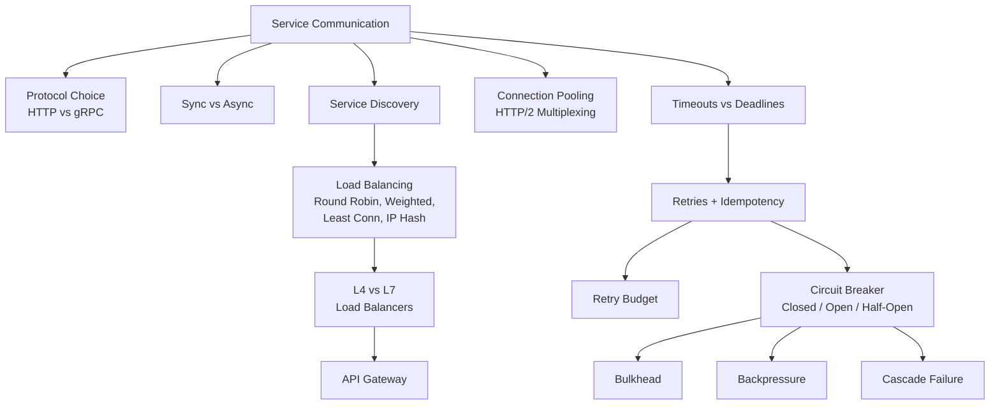
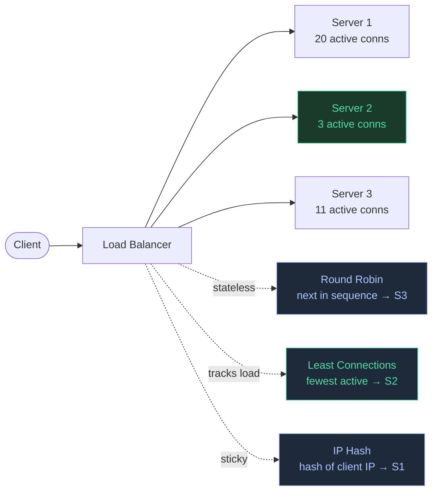
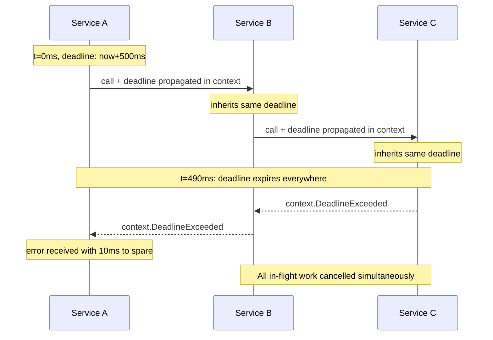
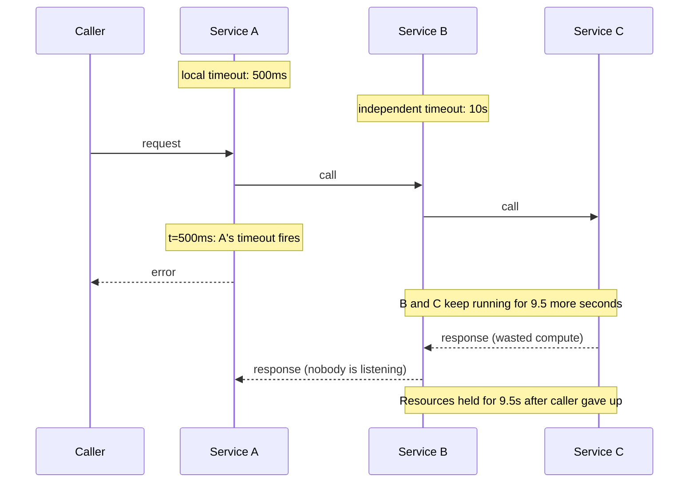
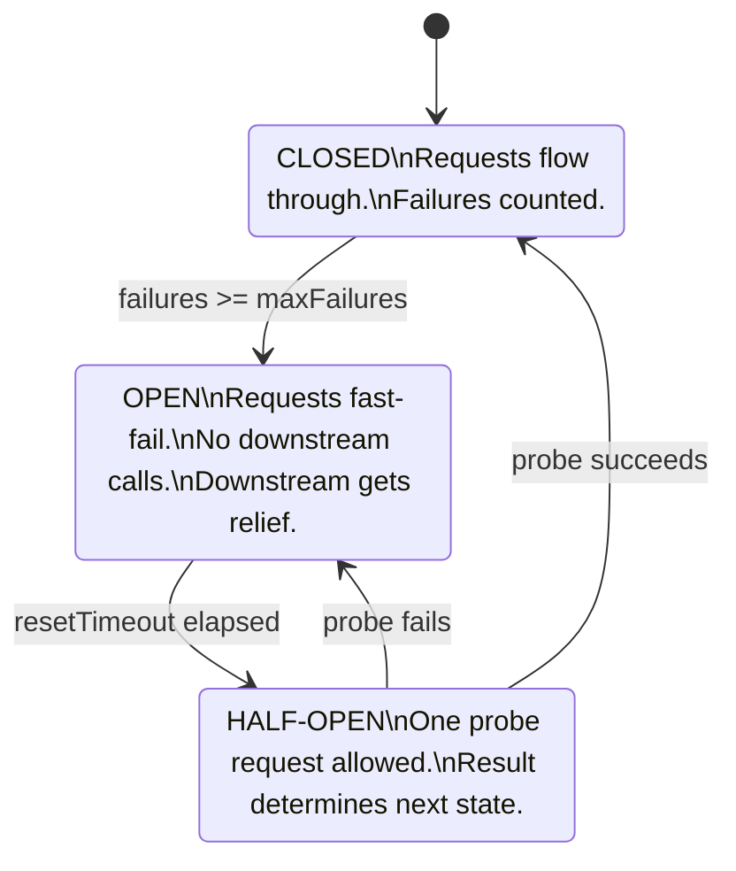
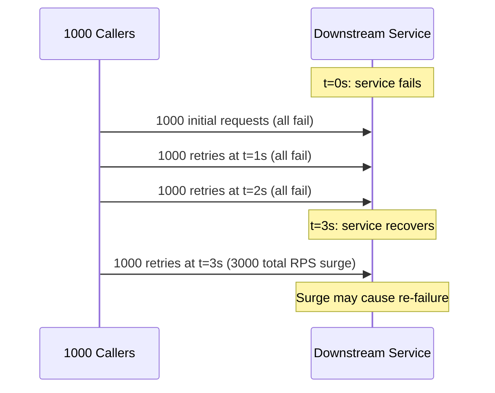
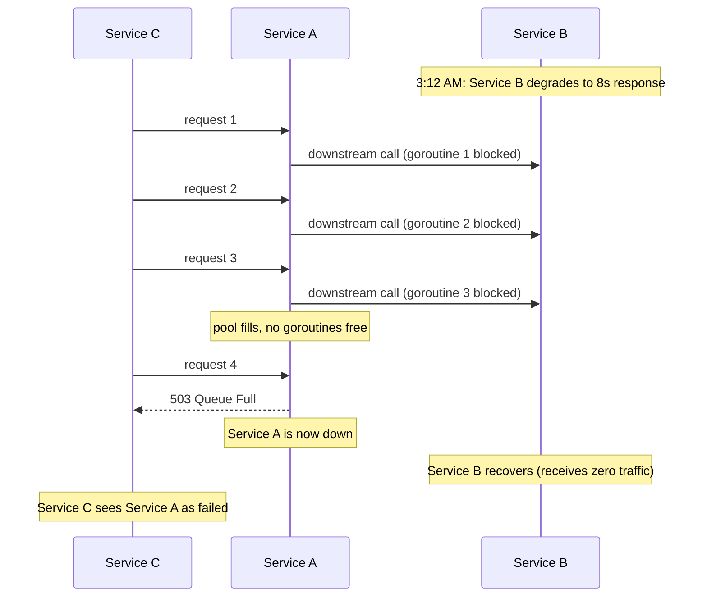
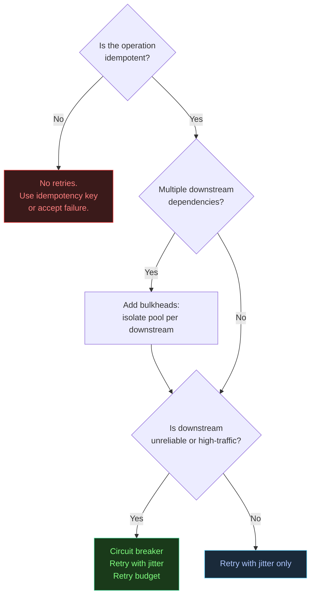

## TL;DR

- A deadline propagates end-to-end across every service hop. A timeout is local to one call. Use deadlines, not raw timeouts, in service-to-service calls.
- Retries without idempotency guarantees cause double charges, duplicate emails, and corrupted state. Always prove a call is idempotent before adding a retry.
- When a downstream service slows, your connection pool fills. When your pool fills, you go down too. Circuit breakers break this chain before it completes.

---

## The Problem

Your service handles 50,000 requests per second. At 3:12 AM, one downstream service starts responding in 8 seconds instead of 50 milliseconds. Within 90 seconds, every goroutine in your pool is blocked waiting on that call. New requests queue behind them. The queue fills. Your load balancer starts seeing timeouts. It retries. Now three times the traffic is hitting the already-overwhelmed downstream service. Your service falls over. The downstream service, now receiving zero traffic, recovers. One slow service took down three others in under two minutes.

This is cascade failure (also called the domino effect): a failure in one component propagates downstream and causes failures in services that had nothing else wrong with them. It is the defining failure mode of distributed systems.

The engineers who built the failing service did not make an obvious mistake. They handled errors. They set timeouts. They tested their service under normal load. What they did not do was ask: "What happens to every service that calls us when we are slow?" and "What happens to our callers when their callers start retrying?"

This chapter covers the communication patterns that answer those questions: how services find each other, how load is distributed, how timeouts and deadlines bound latency, how retries amplify or absorb failures depending on how they are implemented, and how circuit breakers, bulkheads, and backpressure keep a local failure from becoming a system-wide outage.

---

## Chapter Map



---

## Mental Model

Think of a circuit breaker exactly like the one in your home's electrical panel. Under normal load, current flows freely through the closed breaker. When a fault causes a current spike, the breaker trips open in milliseconds, stopping the flow before the wiring catches fire. It does not ask whether the fault is permanent. It simply interrupts the circuit and waits. After a short time, you can flip the breaker to test whether the fault has cleared: if the current is normal, the breaker stays closed; if the fault is still there, it trips again immediately.

This maps precisely to the software circuit breaker. Under normal operation (closed state), requests flow to the downstream service. When consecutive failures exceed a threshold, the circuit trips open and fast-fails all requests with no network call made. After a reset timeout, it allows one probe request (the half-open state). If the probe succeeds, the circuit closes. If the probe fails, it trips open again.

The analogy breaks down in one place: a home circuit breaker acts on current, an objective physical quantity. A software circuit breaker acts on error rate or latency, which are sampled and approximate. A downstream service that is slow but technically responding may not trip the breaker until your timeout fires, which may be seconds into a failed request. The electrical version reacts in microseconds; the software version reacts over multiple request cycles.

---

## How It Works

### HTTP vs RPC vs gRPC

Every service-to-service call is a remote procedure call (RPC): one service invokes an operation on another service across a network. The question is what protocol carries that call.

**HTTP/REST** uses standard HTTP verbs (GET, POST, PUT, DELETE) with JSON bodies. Every engineer knows it. It is trivially debuggable with curl. Its weakness is that it is untyped at the wire level. The client and server agree on a JSON schema by convention, not by contract. If the server changes a field name, the client silently gets a zero value.

**gRPC** uses HTTP/2 as its transport and Protocol Buffers (protobuf) as its serialization format. The contract is defined in a `.proto` file that generates type-safe client and server code in any supported language. Protobuf serializes to binary: a typical JSON payload of 1 KB becomes 150 to 300 bytes in protobuf, which matters at high RPC volume. The weakness is debuggability: you cannot curl a gRPC endpoint without special tooling, and protobuf binary is not human-readable.

The rule: use REST for external APIs where any client needs to call you without special tooling. Use gRPC for internal service-to-service calls where you control both ends and want type safety, performance, and streaming support.

### Synchronous vs Asynchronous Communication

**Synchronous communication**: the caller blocks until the callee responds. HTTP and gRPC are synchronous by default. The caller's goroutine is tied up for the duration of the call. If the callee is slow, the caller is slow.

**Asynchronous communication**: the caller publishes a message to a queue or topic (Kafka, RabbitMQ, SQS) and returns immediately. The callee processes the message on its own schedule. The caller does not wait and does not know when processing completes.

Async decouples the caller from the callee's availability and speed. The cost is complexity: you need a message broker, you lose the simple request/response mental model, and error handling becomes harder (how does the caller know if the callee failed two hours later?).

Use synchronous for user-facing reads where the user is waiting for a response. Use asynchronous for writes that can be processed later (order placement, email sending, analytics events) or when the callee's workload is unpredictable.

### Service Discovery

Before Service A can call Service B, Service A must know Service B's IP address and port. In a static deployment with one server, you hardcode this. In a production system with hundreds of instances scaling up and down, you need service discovery.

**DNS-based discovery**: each service registers under a DNS name. The DNS record returns one or more IP addresses. Simple, works with any HTTP client, and does not require additional infrastructure. The weakness is TTL: DNS records cache for 30 to 60 seconds by default, so a failed instance stays in the DNS record until TTL expires.

**Client-side discovery**: the service queries a registry (Consul, etcd, Eureka) directly, gets the list of healthy instances, and chooses one using its own load balancing logic. More flexible, but every service needs the registry client library.

**Server-side discovery**: the service calls a load balancer or proxy (Nginx, Envoy, AWS ELB), which does the registry lookup and routing. The service does not know about the registry at all. This is simpler for service authors at the cost of an extra network hop.

Most Kubernetes deployments use server-side discovery: each service gets a stable DNS name (e.g., `payment-service.production.svc.cluster.local`), which resolves to a ClusterIP. kube-proxy routes ClusterIP traffic to a healthy pod. The service calls the DNS name and Kubernetes handles the rest.

### Load Balancing

A load balancer (LB) distributes incoming requests across a pool of backend servers. The choice of algorithm affects latency distribution, resource utilization, and behavior under partial failures.

**Round robin**: each request goes to the next server in sequence. Simple, zero state required. Works well when all requests have similar cost and all servers have similar capacity. Breaks when request cost varies significantly: a slow 10-second request on server 1 does not stop it from receiving the next request in the rotation.

**Weighted round robin**: like round robin, but servers with higher capacity receive proportionally more requests. If server A has 8 CPUs and server B has 4, A gets twice the traffic. Requires manual weight configuration or auto-scaling integration.

**Least connections**: each new request goes to the server with the fewest active connections. Better than round robin for requests with variable processing time because it naturally routes away from busy servers. Requires the LB to track active connections per backend.

**IP hash (consistent hash)**: a hash of the client's IP address determines which server handles the request. The same client always goes to the same server. Useful for session affinity (stateful services that cache client data). The weakness: a single heavy-hitting client always goes to the same server regardless of that server's load.

**Random with two choices (power of two choices)**: pick two servers at random, then route to the less loaded of the two. This achieves near-optimal load distribution with much less coordination overhead than fully-centralized least-connections tracking. This is what many modern load balancers use internally.



### Layer 4 vs Layer 7 Load Balancing

**Layer 4 (transport layer)**: the LB routes based on IP address and TCP/UDP port. It does not look at HTTP headers, cookies, or request paths. This is fast (a few microseconds per routing decision) and works with any protocol. The LB simply forwards TCP connections to backend servers. HAProxy in TCP mode and AWS NLB operate at Layer 4.

**Layer 7 (application layer)**: the LB terminates the HTTP connection, reads the request headers and path, and routes based on that content. It can route `/api/users` to the user service and `/api/payments` to the payment service. It can inspect cookies for session affinity. It can inject headers. It costs more CPU per request than Layer 4. Nginx in HTTP mode, AWS ALB, and Envoy operate at Layer 7.

Use Layer 4 when you need raw throughput and do not need to inspect request content. Use Layer 7 when you need path-based routing, SSL termination, authentication, or observability at the HTTP level.

### API Gateways

An API gateway is a Layer 7 load balancer with additional responsibilities: authentication, rate limiting, request transformation, SSL termination, and observability. External clients talk to the API gateway; the gateway routes to internal services.

The gateway is the system boundary between untrusted external callers and your internal services. It enforces authentication so internal services do not need to. It rate limits so internal services are not flooded by one client. It transforms request formats so internal services can evolve their APIs without breaking clients.

The cost: the gateway is a choke point. If it is unavailable, nothing reaches your services. If it is slow, everything is slow. It needs to be as highly available and low-latency as any critical internal service.

### Connection Pooling

Opening a TCP connection takes 3 roundtrips (TCP handshake + TLS handshake for HTTPS). At 50ms per roundtrip to a service in a different region, that is 150ms of overhead before the first byte of your request is sent. If your average request takes 20ms, connection setup dominates.

Connection pooling maintains a pool of open, reusable connections to each backend. When a request arrives, it borrows a connection from the pool, uses it, and returns it. No handshake needed.

The pool has a maximum size. When all connections are in use and a new request arrives, it waits for a connection to be returned. If the downstream service is slow, connections are returned slowly. The pool fills. New requests queue. This is connection pool exhaustion, one of the most common causes of cascade failures.

**HTTP/2 multiplexing**: HTTP/1.1 allows one in-flight request per TCP connection. HTTP/2 multiplexes multiple requests over a single connection (multiple streams, one connection). gRPC uses HTTP/2 by default. This reduces the number of connections needed by an order of magnitude and eliminates most connection setup overhead in internal networks.

**HTTP/3 / QUIC**: HTTP/3 uses QUIC (a UDP-based transport) instead of TCP. QUIC eliminates head-of-line blocking (the problem where a lost packet on one stream stalls all streams sharing a TCP connection). QUIC also reduces handshake latency from 3 RTTs to 1 RTT for new connections and 0 RTTs for resumed connections. For services communicating over unreliable or high-latency networks, HTTP/3 materially reduces tail latency.

### Timeouts vs Deadlines

This distinction matters more than any other in this chapter.

A **timeout** is local to one call. If you call service B with a 500ms timeout and service B calls service C, service C does not know about your 500ms constraint. Service C's own timeout might be 10 seconds. By the time service C times out, your 500ms is long gone and service A is already returning an error to its caller.

A **deadline** is an absolute timestamp propagated end-to-end across every hop. When service A creates a deadline of `now + 500ms` and passes it to service B in the request context, service B passes that same deadline to service C. Every service in the chain knows when the original caller's patience runs out. When the deadline expires, every service in the chain cancels its work simultaneously. No service wastes resources on a request that will never reach its caller.

gRPC propagates deadlines automatically: the client sets a deadline on the context, and gRPC includes it in the request metadata. Every hop that uses the same context inherits the deadline. HTTP does not propagate deadlines automatically: you must include the remaining time budget in a header (e.g., `X-Request-Deadline`) and have each service reconstruct the context from it.



Without deadline propagation, each service has its own independent timeout:



### Retries and Idempotency

Retries are how you handle transient failures: network blips, temporary service overload, brief hardware hiccups. A request fails, you wait a moment, and try again. Simple.

The danger: retrying a non-idempotent operation causes real harm. An operation is **idempotent** if performing it multiple times produces the same result as performing it once. GET is idempotent: reading the same record twice returns the same data (assuming no writes in between). A well-implemented PUT is idempotent: setting a field to the same value twice leaves the system in the same state. POST to create a record is typically not idempotent: two POSTs create two records.

If your payment service crashes after debiting an account but before returning success, the caller retries. The debit runs twice. The user pays twice. This is not a theoretical risk: it is a production incident class that causes real financial harm.

The fix: idempotency keys. The caller generates a unique key for the operation (a UUID tied to the logical operation, not to the HTTP request). The callee checks whether that key has already been processed. If yes, it returns the cached result without re-executing. If no, it executes and stores the result under that key.

Only retry operations you can prove are idempotent. For non-idempotent operations, use an idempotency key or accept that the failure requires human intervention.

### Retry Budgets

Even with idempotent operations, unbounded retries cause retry storms (covered in depth in "What Can Go Wrong"). A **retry budget** caps the total number of retries across all callers over a time window.

The simplest form: allow at most N retries per second across the service, regardless of how many callers are retrying. If the downstream is at 1,000 RPS normally and allows a 10% retry budget, at most 100 retries per second are allowed. This prevents a cascade where 1,000 callers each retry 3 times, sending 3,000 RPS to a service already struggling at 1,000.

Envoy implements per-service retry budgets in its routing configuration. When the budget is exhausted, retries are rejected locally with a `503 Service Unavailable` before any network call is made.

### Circuit Breakers

The circuit breaker pattern (named after the electrical component) wraps calls to a downstream service and trips open when that service is failing, fast-failing all subsequent requests without making any network call.

Three states:

**Closed** (normal): requests flow through. Failures are counted. When consecutive failures exceed a threshold, the circuit trips open.

**Open** (tripped): all requests are rejected immediately with a local error. No network call is made. This is fast-fail: the caller gets an error in microseconds instead of waiting for a slow or dead downstream. This also gives the downstream service breathing room to recover by dramatically reducing its incoming traffic.

**Half-Open** (recovery probe): after a configurable reset timeout, the circuit allows one request through. If that probe succeeds, the circuit closes and normal operation resumes. If the probe fails, the circuit trips open again and the reset timer restarts.



The circuit breaker does not make your system more reliable in the sense of returning correct results. It makes failures faster and more local. A slow downstream that takes 10 seconds to fail becomes a local circuit-open error that takes microseconds. That difference is what prevents one service's slowness from exhausting your connection pool and taking you down.

### Bulkheads

A **bulkhead** isolates resources for each downstream dependency. The name comes from ship design: watertight compartments ensure that flooding one section does not sink the whole ship.

In practice: instead of one shared connection pool for all downstream calls, you create a separate pool per downstream. If the payment service's pool fills because payment is slow, the user service's pool is unaffected. Calls to the user service still work.

The same principle applies to thread pools: Hystrix (Netflix's circuit breaker library) popularized the pattern of running each downstream call in its own thread pool with a fixed size. If the pool is full, the call is rejected immediately rather than queuing indefinitely.

Bulkheads add resource overhead (more connections, more threads) but eliminate cross-service contamination. The cost is predictable: pool size times memory per connection per downstream. The benefit is that one slow downstream cannot take down an unrelated feature.

### Backpressure

Backpressure is a signal from a downstream service to its callers saying "I am at capacity. Slow down." Without backpressure, a producer generating requests faster than the consumer can process them causes the consumer's queue to grow until it runs out of memory, or causes processing to fall so far behind that responses are useless by the time they arrive.

**Explicit backpressure**: the consumer returns a `429 Too Many Requests` or `503 Service Unavailable` response with a `Retry-After` header. The caller is expected to slow down or queue locally. This is the HTTP approach.

**Implicit backpressure**: in streaming systems (gRPC bidirectional streaming, TCP), the receiver controls how fast data arrives by controlling how fast it reads from the buffer. If the receiver stops reading, the sender's write buffer fills. When the write buffer fills, the sender blocks. This propagates the backpressure upstream through the call stack automatically.

Kafka uses implicit backpressure for consumers: the consumer controls its poll rate and fetch size. If a consumer is slow, it simply does not fetch more messages. The messages stay in Kafka's log. Kafka does not push messages; consumers pull them. This is why Kafka consumer groups can fall behind (high consumer lag) without crashing; they just slow down.

### mTLS

**Mutual TLS (mTLS)** extends standard TLS: in normal HTTPS, only the server presents a certificate. In mTLS, both client and server present certificates. The server verifies the client's certificate against a trusted CA (certificate authority), and vice versa. This means both sides are authenticated: the client knows it is talking to the legitimate server, and the server knows the client is a legitimate service rather than an attacker on the internal network.

mTLS is the standard authentication mechanism in service meshes (Istio, Linkerd). The mesh sidecar proxy (usually Envoy) handles certificate issuance and rotation transparently. Services do not implement mTLS in their application code; the sidecar handles it at the network layer.

Without mTLS, any process that can reach your internal network can call your internal services. With mTLS, only services with valid certificates issued by your internal CA can connect.

### gRPC Streaming Modes

gRPC supports four communication patterns built on HTTP/2 streams:

**Unary RPC**: one request, one response. The same as a standard HTTP request. Used for most operations.

**Server streaming**: one request, a stream of responses. The client sends one message, the server sends back multiple messages over time, then closes the stream. Used for: watching a feed of events, downloading a large dataset in chunks.

**Client streaming**: a stream of requests, one response. The client sends multiple messages, the server accumulates them and responds once at the end. Used for: uploading large files in chunks, streaming sensor data.

**Bidirectional streaming**: both sides send streams simultaneously over a single connection. Used for: real-time collaborative editing, chat, live game state synchronization.

Streaming over HTTP/2 means all messages in a stream share one TCP connection. This eliminates per-request connection setup overhead. Deadlines on streaming RPCs apply to the entire stream's lifetime, not per-message.

---

## Go Implementation

### Deadline Propagation

```go
// deadline_demo.go
// Run with: go run deadline_demo.go
package main

import (
	"context"
	"fmt"
	"net/http"
	"net/http/httptest"
	"time"
)

// BAD: http.Get has no context parameter.
// If the server never responds, this goroutine blocks indefinitely.
// In production, the goroutine pool exhausts and new requests queue behind blocked ones.
func fetchNaive(url string) error {
	resp, err := http.Get(url) //nolint:noctx
	if err != nil {
		return fmt.Errorf("fetch: %w", err)
	}
	defer resp.Body.Close()
	return nil
}

// CORRECT: context deadline cancels the in-flight request when the deadline expires.
// The deadline propagates into the HTTP transport, which closes the connection.
func fetchWithDeadline(ctx context.Context, url string) error {
	req, err := http.NewRequestWithContext(ctx, http.MethodGet, url, nil)
	if err != nil {
		return fmt.Errorf("build request: %w", err)
	}
	resp, err := http.DefaultClient.Do(req)
	if err != nil {
		return fmt.Errorf("fetch: %w", err)
	}
	defer resp.Body.Close()
	return nil
}

func main() {
	// Simulate a slow server: responds after 2 seconds.
	slow := httptest.NewServer(http.HandlerFunc(func(w http.ResponseWriter, r *http.Request) {
		time.Sleep(2 * time.Second)
		w.WriteHeader(http.StatusOK)
	}))
	defer slow.Close()

	// BAD: no timeout. Waits the full 2 seconds.
	start := time.Now()
	err := fetchNaive(slow.URL)
	fmt.Printf("naive:    took %v, err: %v\n", time.Since(start).Round(10*time.Millisecond), err)

	// CORRECT: 500ms deadline, cancels early.
	ctx, cancel := context.WithTimeout(context.Background(), 500*time.Millisecond)
	defer cancel()
	start = time.Now()
	err = fetchWithDeadline(ctx, slow.URL)
	fmt.Printf("deadline: took %v, err: %v\n", time.Since(start).Round(10*time.Millisecond), err)
}

// Output:
// naive:    took 2s, err: <nil>
// deadline: took 500ms, err: fetch: Get "http://127.0.0.1:...": context deadline exceeded
```

At scale: at 10,000 concurrent requests and a 2-second downstream response time, the naive version holds 10,000 goroutines. Each goroutine uses roughly 8 KB of stack. That is 80 MB of goroutine stack just for blocked HTTP callers, plus the connection pool exhausts long before that. The deadline version caps resource usage to `pool_size * deadline_duration`.

### Retry with Exponential Backoff and Jitter

```go
// retry_demo.go
// Run with: go run retry_demo.go (requires Go 1.22+)
package main

import (
	"context"
	"fmt"
	"math"
	"math/rand"
	"time"
)

// BAD: fixed interval between retries. When 1,000 callers all fail at the same
// time and all retry after exactly 1 second, they create a thundering herd:
// 1,000 simultaneous retries hit the recovering service at t+1s, t+2s, t+3s.
// This is a retry storm. The service cannot recover because each wave of retries
// resets its ability to drain its queue.
func retryFixed(ctx context.Context, fn func() error, maxAttempts int) error {
	var lastErr error
	for attempt := range maxAttempts {
		lastErr = fn()
		if lastErr == nil {
			return nil
		}
		fmt.Printf("  [fixed] attempt %d failed: %v\n", attempt+1, lastErr)
		if attempt < maxAttempts-1 {
			time.Sleep(500 * time.Millisecond) // BAD: same interval every time
		}
	}
	return fmt.Errorf("all %d attempts failed: %w", maxAttempts, lastErr)
}

// CORRECT: exponential backoff with full jitter. Each caller picks a random
// wait time from [0, min(cap, base * 2^attempt)]. The randomness spreads
// retries across time, preventing thundering herds. Respects context cancellation
// so the caller can abort the retry loop when its own deadline expires.
func retryWithJitter(ctx context.Context, fn func() error, maxAttempts int) error {
	const (
		baseDelay = 100 * time.Millisecond
		maxDelay  = 10 * time.Second
	)
	var lastErr error
	for attempt := range maxAttempts {
		lastErr = fn()
		if lastErr == nil {
			return nil
		}
		fmt.Printf("  [jitter] attempt %d failed: %v\n", attempt+1, lastErr)
		if attempt == maxAttempts-1 {
			break
		}
		// Full jitter: pick randomly from [0, ceiling].
		// ceiling = min(maxDelay, baseDelay * 2^attempt)
		ceiling := time.Duration(math.Min(
			float64(maxDelay),
			float64(baseDelay)*math.Pow(2, float64(attempt)),
		))
		jitter := time.Duration(rand.Int63n(int64(ceiling) + 1))
		select {
		case <-time.After(jitter):
		case <-ctx.Done():
			return fmt.Errorf("context cancelled during retry backoff: %w", ctx.Err())
		}
	}
	return fmt.Errorf("all %d attempts failed: %w", maxAttempts, lastErr)
}

func main() {
	ctx := context.Background()
	callCount := 0
	// Service that fails the first 2 calls, then succeeds.
	service := func() error {
		callCount++
		if callCount < 3 {
			return fmt.Errorf("service unavailable")
		}
		return nil
	}

	fmt.Println("=== BAD: fixed interval (all callers retry in sync) ===")
	callCount = 0
	err := retryFixed(ctx, service, 5)
	if err != nil {
		fmt.Printf("fixed: error: %v\n", err)
	} else {
		fmt.Printf("fixed: succeeded after %d calls\n", callCount)
	}

	fmt.Println("\n=== CORRECT: exponential backoff with jitter ===")
	callCount = 0
	err = retryWithJitter(ctx, service, 5)
	if err != nil {
		fmt.Printf("jitter: error: %v\n", err)
	} else {
		fmt.Printf("jitter: succeeded after %d calls\n", callCount)
	}
}

// Output:
// === BAD: fixed interval (all callers retry in sync) ===
//   [fixed] attempt 1 failed: service unavailable
//   [fixed] attempt 2 failed: service unavailable
// fixed: succeeded after 3 calls
//
// === CORRECT: exponential backoff with jitter ===
//   [jitter] attempt 1 failed: service unavailable
//   [jitter] attempt 2 failed: service unavailable
// jitter: succeeded after 3 calls
```

Failure injection: simulate a non-idempotent call to demonstrate why retries are dangerous.
Uncomment the idempotency check inside the callee to observe how it prevents double-execution:

```go
// if alreadyProcessed(idempotencyKey) { return cachedResult(idempotencyKey) }
```

At scale: at 5,000 callers each retrying 3 times with fixed intervals, the downstream receives 15,000 RPS instead of 5,000 when it is already struggling. With full jitter, the same 5,000 callers' retries are spread across the backoff window, rarely coinciding. The recovering service sees a gradual ramp rather than three synchronized hammers.

### Circuit Breaker

```go
// circuit_breaker.go
// Run with: go run circuit_breaker.go
package main

import (
	"context"
	"errors"
	"fmt"
	"sync"
	"time"
)

// State represents the circuit breaker's state machine.
type State int

const (
	StateClosed   State = iota // normal: requests flow through, failures counted
	StateOpen                  // tripped: requests rejected immediately, no calls made
	StateHalfOpen              // recovery: one probe request allowed
)

func (state State) String() string {
	switch state {
	case StateClosed:
		return "CLOSED"
	case StateOpen:
		return "OPEN"
	case StateHalfOpen:
		return "HALF-OPEN"
	default:
		return "UNKNOWN"
	}
}

// ErrCircuitOpen is returned when the circuit is open and fast-fails the caller.
var ErrCircuitOpen = errors.New("circuit open: downstream unavailable, fast-failing")

// CircuitBreaker wraps calls to a downstream and trips open on repeated failures.
type CircuitBreaker struct {
	mu           sync.Mutex
	state        State
	failures     int
	maxFailures  int
	openUntil    time.Time
	resetTimeout time.Duration
}

func NewCircuitBreaker(maxFailures int, resetTimeout time.Duration) *CircuitBreaker {
	return &CircuitBreaker{
		state:        StateClosed,
		maxFailures:  maxFailures,
		resetTimeout: resetTimeout,
	}
}

// Call executes fn if the circuit allows it, or returns ErrCircuitOpen immediately.
// A successful call in half-open state closes the circuit.
// A failed call in half-open state trips the circuit open again.
func (cb *CircuitBreaker) Call(ctx context.Context, fn func(context.Context) error) error {
	cb.mu.Lock()
	switch cb.state {
	case StateOpen:
		if time.Now().Before(cb.openUntil) {
			cb.mu.Unlock()
			return ErrCircuitOpen
		}
		// Reset timeout elapsed: allow one probe.
		cb.state = StateHalfOpen
	}
	cb.mu.Unlock()

	err := fn(ctx)

	cb.mu.Lock()
	defer cb.mu.Unlock()

	if err != nil {
		cb.failures++
		if cb.state == StateHalfOpen || cb.failures >= cb.maxFailures {
			cb.state = StateOpen
			cb.openUntil = time.Now().Add(cb.resetTimeout)
			fmt.Printf("  circuit TRIPPED OPEN (failures: %d)\n", cb.failures)
		}
		return err
	}

	// Success: close the circuit and reset failure count.
	if cb.state == StateHalfOpen {
		fmt.Println("  probe succeeded: circuit CLOSED")
	}
	cb.state = StateClosed
	cb.failures = 0
	return nil
}

func main() {
	cb := NewCircuitBreaker(3, 100*time.Millisecond)

	// Downstream service: fails first 3 actual calls, then succeeds.
	actualCalls := 0
	downstream := func(ctx context.Context) error {
		actualCalls++
		if actualCalls <= 3 {
			return fmt.Errorf("downstream error")
		}
		return nil
	}

	for attempt := 1; attempt <= 10; attempt++ {
		err := cb.Call(context.Background(), downstream)
		switch {
		case errors.Is(err, ErrCircuitOpen):
			fmt.Printf("attempt %2d: fast-fail (circuit %s, no network call)\n", attempt, cb.state)
		case err != nil:
			fmt.Printf("attempt %2d: failed: %v (circuit %s)\n", attempt, err, cb.state)
		default:
			fmt.Printf("attempt %2d: success (circuit %s)\n", attempt, cb.state)
		}
		time.Sleep(40 * time.Millisecond)
	}
	fmt.Printf("\nTotal actual downstream calls: %d (of 10 attempts)\n", actualCalls)
}

// Output:
// attempt  1: failed: downstream error (circuit CLOSED)
// attempt  2: failed: downstream error (circuit CLOSED)
//   circuit TRIPPED OPEN (failures: 3)
// attempt  3: failed: downstream error (circuit OPEN)
// attempt  4: fast-fail (circuit OPEN, no network call)
// attempt  5: fast-fail (circuit OPEN, no network call)
//   probe succeeded: circuit CLOSED
// attempt  6: success (circuit CLOSED)
// attempt  7: success (circuit CLOSED)
// attempt  8: success (circuit CLOSED)
// attempt  9: success (circuit CLOSED)
// attempt 10: success (circuit CLOSED)
//
// Total actual downstream calls: 4 (of 10 attempts)
```

Failure injection: observe the half-open probe failing and re-opening the circuit.
Change the downstream to fail the first 4 calls instead of 3:

```go
// if actualCalls <= 4 { return fmt.Errorf("downstream error") }
```

At scale: without a circuit breaker, 10,000 callers waiting on a dead downstream each hold a goroutine and a connection for the full timeout duration. With a circuit breaker (maxFailures: 10, resetTimeout: 10s), after the 10th failure the remaining 9,990 callers get a local error in under a microsecond. The dead downstream receives zero traffic and can recover without being pounded.

---

## Real System Examples

### AWS Aurora Reader Endpoint

Aurora MySQL clusters include a Reader Endpoint: a single DNS hostname that internally distributes read queries across all available read replicas. The load balancing algorithm is DNS-based round-robin. Aurora's control plane updates the DNS record when a replica is added, removed, or fails its health check.

An application connects to `cluster-ro-id.region.rds.amazonaws.com` as if it were a single host. Aurora handles routing. No client-side load balancing library is required. This is Layer 4 DNS load balancing handled transparently by the managed service.

The limitation: DNS caches. If a replica fails between DNS TTL cycles (Aurora uses 1-second TTL for the reader endpoint), connections that have already resolved the DNS entry and established a connection may still attempt to send queries to the failed replica. Drivers with connection pool health checking detect the failed connection and re-connect, triggering a fresh DNS lookup. This is why Aurora strongly recommends driver-level connection validation (`validationQuery`, `testOnBorrow`) in connection pools.

### Nginx and HAProxy: L4 vs L7

Nginx in `stream` mode (Layer 4) proxies TCP connections without reading their content. It is fast (kernel-level forwarding paths) and works with any TCP protocol: MySQL, Redis, gRPC, raw WebSocket. It does not know what protocol runs over the TCP connection; it simply forwards bytes.

Nginx in `http` mode (Layer 7) terminates HTTP connections, reads headers and paths, and can route `/api/v1/users` to one upstream and `/api/v1/payments` to another. It can inspect cookies, inject headers, and log individual HTTP requests with status codes. It costs roughly 2x the CPU per request compared to Layer 4 for the same throughput.

HAProxy follows the same split: `mode tcp` for Layer 4, `mode http` for Layer 7. HAProxy's Layer 4 mode has better raw throughput than Nginx's stream module for very high-connection workloads (100k+ concurrent connections), which is why HAProxy is still preferred in front of TCP-heavy services like database clusters.

### Envoy: Circuit Breaking and Retry Policies

Envoy (the proxy used by Istio and many Kubernetes service meshes) implements circuit breaking through outlier detection. Configuration example:

```yaml
outlier_detection:
  consecutive_5xx: 5           # trip after 5 consecutive 5xx responses
  interval: 10s                # evaluation window
  base_ejection_time: 30s      # how long to eject a failed host
  max_ejection_percent: 50     # never eject more than 50% of hosts at once
```

When a backend instance exceeds `consecutive_5xx`, Envoy ejects it from the load balancing pool for `base_ejection_time`. Subsequent ejections of the same host double the ejection time (up to a cap), implementing exponential backoff at the proxy level. The `max_ejection_percent` guard prevents Envoy from ejecting so many hosts that the pool collapses.

Envoy also implements retry budgets globally per cluster, limiting total retries to a percentage of non-retry traffic. This prevents retry storms at the proxy layer without requiring application-level retry budget logic.

### gRPC: Deadline Propagation

gRPC propagates deadlines automatically. When a client creates an RPC with a context deadline, gRPC encodes it as a `grpc-timeout` header in the HTTP/2 request. The server-side gRPC framework reads that header and constructs a `context.Context` with the matching deadline before invoking the handler. If the handler calls another gRPC service using that context, the deadline propagates to the third service automatically.

If the propagated deadline has already expired by the time the server receives the request (due to queuing delays), gRPC rejects the request immediately with `DEADLINE_EXCEEDED` before the handler even runs. This prevents the system from spending compute on requests whose callers have already given up.

---

## What Can Go Wrong

### Retry Storm

A service with 1,000 callers experiences a 60-second outage. Each caller is configured to retry 3 times with a 1-second fixed interval. During those 60 seconds, each caller fires: initial attempt, retry at t+1s, retry at t+2s, retry at t+3s. That is 4,000 requests from 1,000 callers instead of 1,000. All retries are synchronized because all callers share the same 1-second interval. When the service recovers, it is immediately hit with a synchronized surge that may overwhelm it again.



**Fix**: exponential backoff with full jitter (shown in the Go implementation above), combined with a retry budget of at most 10% of normal traffic. With jitter, the 1,000 callers' retries spread across the backoff window rather than synchronizing. With a retry budget, even with jitter, total retries are capped.

### Connection Pool Exhaustion

```go
// pool_exhaustion_demo.go
// Run with: go run pool_exhaustion_demo.go (requires Go 1.22+)
package main

import (
	"fmt"
	"sync"
	"time"
)

// Pool simulates a connection pool with a fixed maximum size.
type Pool struct {
	mu      sync.Mutex
	inUse   int
	maxSize int
	waiters int
}

func NewPool(maxSize int) *Pool {
	return &Pool{maxSize: maxSize}
}

// Acquire borrows a connection from the pool.
// Returns false immediately if no connections are available.
// BAD: no timeout; in production this would block indefinitely.
func (pool *Pool) Acquire() bool {
	pool.mu.Lock()
	defer pool.mu.Unlock()
	if pool.inUse >= pool.maxSize {
		pool.waiters++
		return false // BAD: in real code this would block, not return false
	}
	pool.inUse++
	return true
}

func (pool *Pool) Release() {
	pool.mu.Lock()
	defer pool.mu.Unlock()
	if pool.inUse > 0 {
		pool.inUse--
	}
}

func (pool *Pool) Status() string {
	pool.mu.Lock()
	defer pool.mu.Unlock()
	return fmt.Sprintf("in-use: %d/%d, waiters: %d", pool.inUse, pool.maxSize, pool.waiters)
}

func main() {
	pool := NewPool(10) // 10-connection pool to downstream service
	var wg sync.WaitGroup

	// Simulate 15 concurrent requests when downstream is slow (holds connections for 500ms).
	for reqNum := range 15 {
		wg.Add(1)
		go func(num int) {
			defer wg.Done()
			acquired := pool.Acquire()
			if !acquired {
				fmt.Printf("request %2d: REJECTED (pool exhausted: %s)\n", num+1, pool.Status())
				return
			}
			defer pool.Release()
			// Simulate slow downstream: holds the connection for 500ms.
			time.Sleep(500 * time.Millisecond)
			fmt.Printf("request %2d: completed\n", num+1)
		}(reqNum)
	}

	wg.Wait()
	fmt.Printf("final pool status: %s\n", pool.Status())
}

// Output (order varies):
// request  1: completed
// ...
// request 11: REJECTED (pool exhausted: in-use: 10/10, waiters: 1)
// request 12: REJECTED (pool exhausted: in-use: 10/10, waiters: 2)
// request 13: REJECTED (pool exhausted: in-use: 10/10, waiters: 3)
// request 14: REJECTED (pool exhausted: in-use: 10/10, waiters: 4)
// request 15: REJECTED (pool exhausted: in-use: 10/10, waiters: 5)
// final pool status: in-use: 0/10, waiters: 5
```

**Fix**: set a pool acquisition timeout. If a connection cannot be acquired within N milliseconds, fail the request immediately with a 503 rather than queuing it. A queued request that waits 10 seconds for a connection is still going to arrive late to a user who gave up after 5 seconds. Combined with a circuit breaker: when the downstream is slow and the pool fills, the circuit breaker trips open and prevents new requests from even attempting pool acquisition.

### Cascade Failure



Cascade failure follows a predictable progression. One service degrades (slow disk I/O, GC pause, memory pressure). Its callers' connections back up. Those callers start failing. Their callers start failing. The failure propagates upstream until it reaches services with no circuit breakers, whose pools exhaust and whose processes run out of goroutines.

**Fix**: the circuit breaker is the primary defense. When service B's response time exceeds the timeout, service A's circuit breaker trips open after a few failures. Service C's calls to service A fail fast. Each service sheds load quickly rather than queuing indefinitely. Combined with bulkheads: service A's pool to service B is isolated from its pool to service D, so B's degradation does not affect A's ability to serve requests that only need D.

---

## Trade-offs

| Approach | Strength | Weakness | Concrete Cost | Use When |
|----------|----------|----------|---------------|----------|
| No retries | Simple, no retry storm risk | Transient failures surface to users | 0 overhead, but higher error rate | Writes that are not idempotent, or callers who handle errors themselves |
| Fixed-interval retry | Simple to implement | Thundering herd on recovery | 2-3x traffic amplification during outages | Never: use jitter instead |
| Exponential backoff + jitter | Spreads retry load, prevents thundering herd | Increases max latency for retried requests | P99 latency increases by up to `maxDelay` for failing requests | Any idempotent read or write |
| Circuit breaker | Fast-fail protects callers, gives downstream recovery time | Adds complexity, needs tuning (thresholds, timeout) | ~1 microsecond per call overhead | Any service-to-service call in production |
| Bulkhead (per-downstream pool) | Isolates failures, prevents cross-service contamination | More connections, more memory | Pool size times ~20 KB per connection per downstream | Any service with 2+ downstream dependencies with different SLAs |
| Backpressure (explicit 429/503) | Producer slows down cleanly | Callers must implement retry + backoff | 0 extra resources on producer | Consumer-side protection; Kafka consumer groups, rate-limited APIs |



---

## Common Misconceptions

**Misconception:** "Retries are safe. If the first request failed, it did not reach the server."

**Reality:** A failed response from the server does not mean the server did not process the request. The server may have processed the write, committed it to the database, and then crashed before sending the acknowledgment. The caller sees a timeout or connection error. If the caller retries, the server processes the write again. Without an idempotency key, the write happens twice. This is exactly how double-charges occur in payment systems.

---

**Misconception:** "A circuit breaker makes my service more reliable."

**Reality:** A circuit breaker makes failures faster and more local. It does not make the downstream service more reliable or make the failed requests succeed. When the circuit is open, callers receive errors immediately instead of waiting. That is better for the system's overall health (the caller does not exhaust its goroutine pool), but the user-facing request still fails. Reliability requires the downstream to actually work. The circuit breaker is damage control, not a reliability improvement.

---

**Misconception:** "Load balancing and service discovery are the same thing."

**Reality:** Service discovery answers "where are the instances?" It maintains a registry of healthy instances with their addresses. Load balancing answers "which instance handles this request?" It applies an algorithm (round robin, least connections) to the list that service discovery provides. They are separate concerns. You can have service discovery without load balancing (always call instance 1). You can have load balancing without a dynamic registry (a hardcoded list of IPs in your nginx config). In practice, they work together, but conflating them leads to confusion when debugging routing issues.

---

## Interview Questions

**Q: How do you handle service failures?**

A model answer: The first layer is timeouts and deadlines. Every service-to-service call has a deadline, not just a local timeout, so the time budget propagates across every hop. The second layer is retries with exponential backoff and jitter, but only for idempotent operations. The third layer is circuit breakers: when a downstream is consistently failing, the circuit trips open and fast-fails calls so my service does not exhaust its goroutine pool waiting on a dead service. The fourth layer is bulkheads: separate connection pools per downstream so one failing service does not bleed into unrelated features. Together these layers mean a failure stays local and bounded rather than cascading.

---

**Q: Why are retries dangerous?**

A model answer: Three reasons. First, retrying a non-idempotent operation causes duplicate side effects: double charges, duplicate emails, double inserts. Second, synchronized retries amplify load. If 1,000 callers all retry with the same 1-second interval, the recovering service receives a 3,000-request surge at t+1s, which may prevent recovery. Third, retries consume resources on the caller side: goroutines, connections, and time budget. If the downstream is truly down, retries just delay the error while consuming resources. The fix is: only retry idempotent operations, use exponential backoff with full jitter, and enforce a retry budget that caps total retry traffic at a fixed percentage of normal traffic.

---

**Q: How do you prevent cascading failures?**

A model answer: Circuit breakers are the primary mechanism. When a downstream degrades, the circuit trips open after a threshold of failures and fast-fails all subsequent calls. This prevents my service's goroutine pool from filling with threads waiting on a slow downstream, which is the primary mechanism of cascade propagation. Beyond circuit breakers: bulkheads ensure a slow downstream does not consume resources needed by unrelated features; deadlines ensure I do not spend time on requests whose original caller has already given up; and retry budgets prevent retry storms from amplifying the initial failure. The key insight is that cascade failures happen because services are too patient with failing downstreams. Circuit breakers make failures fast and local.

---

**Q: How does a load balancer work?**

A model answer: A load balancer sits in front of a pool of backend servers and distributes incoming requests across them. At Layer 4, it routes based on IP and port without reading the request content, forwarding raw TCP connections. At Layer 7, it terminates the HTTP connection, reads headers and paths, and routes based on that content. It maintains a health check for each backend: typically an HTTP GET to a `/health` endpoint every few seconds. Backends that fail health checks are removed from the routing pool. The load balancer applies an algorithm to the healthy pool: round robin, least connections, IP hash, or random with power-of-two-choices. Modern service meshes push this logic into sidecar proxies (Envoy) running alongside each service instance, eliminating the centralized load balancer as a single point of failure.

---

**Q: What is the difference between round robin and least connections?**

A model answer: Round robin sends the first request to server 1, the second to server 2, and so on, cycling through the pool. It is stateless and simple. Its weakness is that it assumes all requests have similar cost. If server 1 receives a 10-second database query while server 2 receives 20 fast 50ms queries, round robin still sends the next request to server 1 even though it is busy. Least connections sends each new request to the server with the fewest active connections. It naturally routes away from busy servers toward idle ones, handling variable-cost requests much better. The cost is that the load balancer must track active connection count per backend, which requires state. For most production workloads with variable request cost (which is almost all of them), least connections produces better latency distribution than round robin.

---

**Q: When would you use IP hash load balancing?**

A model answer: When you need session affinity: the same client must always reach the same backend. This is required for stateful services that cache client session data in memory and cannot or will not share that cache with other instances. IP hash computes a hash of the client's source IP and uses it to pick a backend deterministically. The same IP always maps to the same backend. The weakness is that it can create hot spots: a small number of clients generating heavy traffic always go to the same backends regardless of load. It also breaks when the backend pool changes (a server added or removed remaps many IP hashes). Consistent hashing (a more sophisticated version) minimizes remapping when the pool changes. In modern stateless architectures where session data lives in Redis or a database, IP hash is rarely needed.

---

**Q: How does Aurora manage read replica traffic without client-side changes?**

A model answer: Aurora provides a Reader Endpoint: a single DNS name that resolves to different replica IP addresses on each lookup using DNS round-robin. Applications connect to this single hostname. Aurora's control plane registers all healthy read replicas in the DNS record and uses a 1-second TTL. When a replica is added, its IP appears in the DNS record immediately. When a replica fails its health check, its IP is removed. The application's connection pool, which periodically resolves DNS, picks up the change within one TTL cycle. This is transparent DNS-based Layer 4 load balancing: the application does not know it is talking to multiple hosts; it thinks it is talking to one hostname. The limitation is that DNS round-robin distributes new connections, not query load. A single long-running connection always goes to the same replica it initially resolved to.

---

**Q: How does a circuit breaker prevent a domino effect?**

A model answer: Cascade failure happens because a slow downstream holds goroutines and connections hostage while callers wait for a response that is too slow to be useful. When those goroutines fill the pool, new requests queue. When the queue fills, the caller's service goes down even though it had no internal problems. A circuit breaker interrupts this chain at the first step. After a threshold of failures or timeouts, the breaker trips open and starts returning a local error immediately, in microseconds. No goroutine blocks waiting. No connection is held. The caller's pool stays available for other work. The downstream gets a dramatic reduction in incoming traffic (zero, while the circuit is open), which is exactly what it needs to recover. The breaker then probes the downstream periodically and closes when it recovers. The key insight: cascade failure requires callers to be patient with failing downstreams. The circuit breaker makes callers impatient by design.

---

## Key Takeaways

- Deadlines, not timeouts, are the right abstraction for service-to-service calls. A deadline propagates the original caller's time budget across every hop in the chain. A timeout is local and invisible to the services further downstream, which keep doing work nobody needs.
- The cascade failure pattern is predictable and preventable. One slow service causes its callers' pools to fill. Circuit breakers interrupt this by fast-failing calls to degraded downstreams. Without circuit breakers, one slow service can take down an entire call graph.
- Retries amplify load. A 10% retry rate under normal conditions becomes a 300% surge during an outage if all callers retry synchronously. Exponential backoff with full jitter and retry budgets are not optional features for high-traffic systems; they are the difference between a 2-minute outage and a 20-minute outage.
- Load balancing and service discovery are separate problems. Discovery finds the instances. Load balancing chooses among them. Conflating them leads to architectures that work in development (hardcoded addresses) and fail silently in production (stale addresses after deployments).
- mTLS is not optional in multi-tenant or regulated environments. Without it, any process that reaches your internal network can call your internal services. With mTLS, only services with valid certificates from your internal CA can connect. Service meshes make this transparent to application code.

The core insight of this chapter: in a distributed system, every network call is a bet that the remote service is healthy, the network is reliable, and the response arrives before anyone gives up. Circuit breakers, deadlines, and retry budgets are the mechanisms that make losing that bet survivable.

---

**Series:** Distributed Systems for Backend Engineers
**Previous:** [Distributed Systems Fundamentals](/blogs/ds-01-fundamentals) | **Next:** [Consistency and Replication](/blogs/ds-03-consistency)
