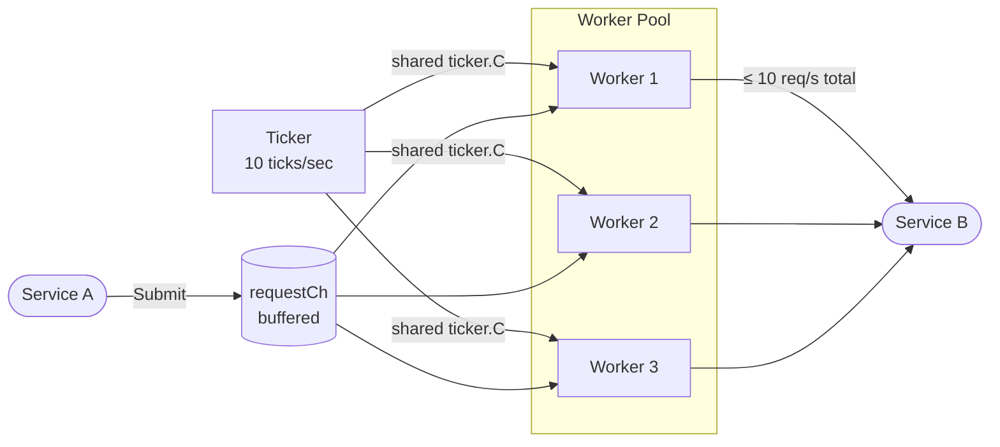
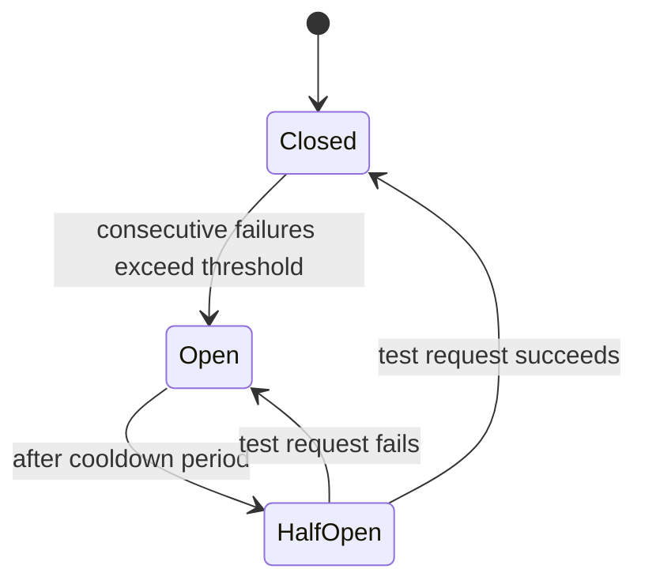
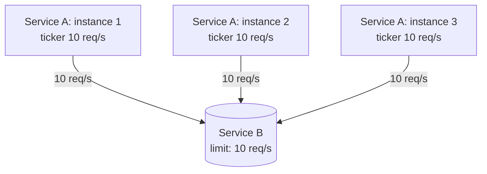

This is one of those interview questions that starts simple and unfolds. The setup sounds easy. Then the follow-ups begin. By the end you have covered worker pools, rate limiting, backpressure, retries, circuit breaking, and distributed coordination.

This post walks through the full answer. By the end you will have a complete, running Go program and an answer to every follow-up question.

## The Problem

You have two services:

**Service A** receives incoming requests. The rate is unpredictable: could be 1 request per second, could be 500.

**Service B** processes those requests but has a hard rate limit: it will reject anything beyond **10 requests per second** with a 429 response.

Your task: design a component in Service A that forwards requests to Service B, never exceeds 10 req/s, handles bursts safely, and shuts down cleanly.


Constraints from the interviewer:
- No Kafka, RabbitMQ, or external queues
- Use Go goroutines and channels
- Avoid unbounded memory growth
- Handle graceful shutdown and cancellation

## What the Interviewer Is Testing

This question is not about syntax. It is about systems thinking applied to Go concurrency primitives.

The interviewer wants to see whether you:

- Understand the difference between concurrency (doing multiple things) and limiting that concurrency to protect a downstream dependency
- Know when a channel is the right tool (rate limiting, backpressure) versus a mutex (shared state)
- Can explain backpressure before the interviewer has to ask about it
- Think about what happens under load and when things fail, not just the happy path
- Know how goroutines exit and what causes leaks

A candidate who writes correct code but misses the buffer size question, or cannot explain what happens when the buffer fills, fails at the systems level even if their code compiles.

## Three Naive Approaches That Do Not Work

### Approach 1: One Goroutine Per Request

```go
for req := range incoming {
    go forwardToServiceB(req) // wrong: no rate control, unbounded goroutines
}
```

Two problems. First, this spawns one goroutine per request. At 500 req/s, you have 500 goroutines simultaneously hitting Service B. Service B starts returning 429. Now all 500 goroutines retry. Memory grows without bound.

Second, there is no rate limiting. You are sending as fast as the goroutines can run, which is far faster than 10 req/s.

### Approach 2: Sleep Between Requests

```go
for req := range incoming {
    go func(r Request) {
        time.Sleep(100 * time.Millisecond) // 10 req/s... right?
        forwardToServiceB(r)
    }(req)
}
```

Each goroutine sleeps 100ms and then sends. If 50 requests arrive in the first 10ms, they all sleep, then all send at T=110ms. You just burst 50 requests to Service B in a single millisecond. The sleep does not spread out the sends; it just delays them uniformly.

### Approach 3: Single Goroutine with Sleep

```go
for req := range incoming {
    forwardToServiceB(req) // blocks for the HTTP round-trip
    time.Sleep(100 * time.Millisecond)
}
```

This actually rate limits. But it is sequential. If `forwardToServiceB` takes 50ms, you send one request every 150ms instead of every 100ms. You are leaving 3 req/s of capacity on the table. Worse, one slow request from Service B stalls the entire queue.

The correct solution separates three concerns: a channel buffers work, a ticker enforces the rate, and a pool of workers handles I/O concurrency so Service B's response time does not reduce your throughput.

## The Architecture



Three pieces:

**The request channel** is a bounded buffer. If it fills, the caller blocks. This is backpressure: congestion at Service B propagates back to whoever is submitting requests, slowing them down automatically.

**The ticker** fires every 100ms (10 times per second). It is a single instance shared by all workers. A channel delivers each value to exactly one receiver, so sharing one `ticker.C` across N workers means at most 10 ticks are distributed per second total. This is how you enforce a global rate limit without any locks or atomic counters.

**The workers** are goroutines that each: (1) wait for a request from the channel, (2) wait for a tick from the shared ticker, (3) forward to Service B. Multiple workers exist so that while one worker is blocked waiting for Service B's response, others can be processing subsequent ticks.

## Why Multiple Workers?

The rate limit is 10 req/s, enforced by the ticker. So why have more than one worker?

Consider Service B takes 200ms to respond. With one worker:

```
T=0ms:   worker reads tick, picks up request 1, starts forwarding (200ms I/O)
T=100ms: tick fires; worker is busy; tick goes into ticker's internal buffer (capacity 1)
T=200ms: worker gets response; picks up request 2; reads buffered tick immediately; starts forwarding
T=300ms: tick fires; goes into buffer
T=400ms: worker gets response; picks up request 3; reads buffered tick; starts forwarding
```

`time.NewTicker` creates a channel with an internal buffer of 1, so a single pending tick can be held rather than immediately dropped. Even so, with 200ms I/O and a 100ms tick interval, only one tick arrives per I/O cycle (the second one is held in the buffer and used next cycle). Throughput is 1 request per 200ms: **5 req/s instead of 10 req/s**.

With three workers:

```
T=0ms:   worker 1 reads tick, forwards request 1 (200ms I/O)
T=100ms: worker 2 reads tick, forwards request 2 (200ms I/O)
T=200ms: worker 1 finishes; tick fires; worker 1 reads tick, forwards request 3
T=300ms: worker 2 finishes; tick fires; worker 2 reads tick, forwards request 4
```

The pipeline stays full. You hit 10 req/s consistently.

Rule of thumb: `numWorkers ≥ ceil(Service_B_latency_ms × maxRPS / 1000)`. For 200ms and 10 req/s: `ceil(200 × 10 / 1000) = 2`. Use 3 for headroom.

## Building It

### The Types

```go
// Request is a unit of work received from Service A.
type Request struct {
	ID   int
	Body string
}

// Response is what workers send back after forwarding to Service B.
type Response struct {
	RequestID int
	Err       error
}

// ServiceBError carries the HTTP status code from Service B.
type ServiceBError struct {
	StatusCode int
	Message    string
}

func (e *ServiceBError) Error() string {
	return fmt.Sprintf("service B: status %d: %s", e.StatusCode, e.Message)
}
```

### The Dispatcher Struct

```go
type Dispatcher struct {
	requestCh  chan Request
	resultCh   chan Response
	ticker     *time.Ticker
	numWorkers int
	wg         sync.WaitGroup
	logger     *slog.Logger
}
```

### Constructor

```go
// NewDispatcher creates a Dispatcher.
// bufferSize: how many requests can queue before Submit blocks.
// numWorkers: goroutines handling I/O to Service B.
// maxRPS:     maximum requests per second forwarded to Service B.
func NewDispatcher(bufferSize, numWorkers, maxRPS int, logger *slog.Logger) *Dispatcher {
	interval := time.Second / time.Duration(maxRPS) // 100ms for maxRPS=10
	return &Dispatcher{
		requestCh:  make(chan Request, bufferSize),
		resultCh:   make(chan Response, bufferSize),
		ticker:     time.NewTicker(interval),
		numWorkers: numWorkers,
		logger:     logger,
	}
}
```

`time.Second / time.Duration(maxRPS)` computes the tick interval. For `maxRPS = 10` that is 100ms. The ticker fires every 100ms, delivering a token to exactly one waiting worker each time.

### Submit

```go
// Submit enqueues a request. Blocks when the buffer is full (backpressure).
// Returns ctx.Err() if the context is cancelled before the request is accepted.
func (d *Dispatcher) Submit(ctx context.Context, req Request) error {
	select {
	case d.requestCh <- req:
		return nil
	case <-ctx.Done():
		return ctx.Err()
	}
}
```

If `requestCh` has space, the request is enqueued immediately. If `requestCh` is full, this goroutine blocks until either space opens (a worker processes something) or the context is cancelled. That blocking IS the backpressure mechanism.

### Start and Stop

```go
// Start launches workers and returns a channel of results.
// The results channel closes when all workers have finished.
func (d *Dispatcher) Start(ctx context.Context) <-chan Response {
	for i := 0; i < d.numWorkers; i++ {
		d.wg.Add(1)
		go d.worker(ctx, i)
	}

	go func() {
		d.wg.Wait()
		d.ticker.Stop()
		close(d.resultCh)
	}()

	return d.resultCh
}

// Stop signals that no more requests will come.
// Workers process all remaining queued requests before exiting.
func (d *Dispatcher) Stop() {
	close(d.requestCh)
	d.wg.Wait()
}
```

`Stop()` closes `requestCh`. Workers reading from a closed channel receive `ok == false` and exit after draining whatever is left. The goroutine in `Start` then stops the ticker and closes `resultCh`, which causes the caller's `range results` loop to exit.

Call `Stop()` only after all `Submit` calls are done. Sending to a closed channel panics.

### The Worker

```go
func (d *Dispatcher) worker(ctx context.Context, id int) {
	defer d.wg.Done()

	for {
		// Step 1: wait for a request.
		var req Request
		select {
		case <-ctx.Done():
			return
		case r, ok := <-d.requestCh:
			if !ok {
				return // channel closed, no more requests
			}
			req = r
		}

		// Step 2: wait for rate limit permission.
		// ticker.C is shared: at most maxRPS ticks/sec reach all workers combined.
		select {
		case <-ctx.Done():
			d.trySend(Response{RequestID: req.ID, Err: ctx.Err()})
			return
		case <-d.ticker.C:
		}

		// Step 3: forward to Service B, with retries.
		err := withRetry(ctx, 3, func() error {
			return forwardToServiceB(ctx, req)
		})

		d.trySend(Response{RequestID: req.ID, Err: err})
	}
}

func (d *Dispatcher) trySend(r Response) {
	select {
	case d.resultCh <- r:
	default:
		d.logger.Warn("result channel full, dropping result", "requestID", r.RequestID)
	}
}
```

The two-step select is the core of the design.

Workers first pick up a request, then wait for a tick. This means tokens are only consumed when there is actual work to do. If `requestCh` is empty, all workers are blocked in Step 1 and the ticker fires without anyone consuming the tick. No wasted tokens trying to forward phantom requests.

The global rate limit is enforced because `ticker.C` delivers at most `maxRPS` values per second, and each value is received by exactly one goroutine. It does not matter how many workers are waiting: at most 10 of them get a tick per second, which means at most 10 requests reach Service B per second.

## Retries

Service B returns errors sometimes. Transient errors (5xx, network timeout) are worth retrying. Permanent errors (4xx, except 429) are not.

```go
func withRetry(ctx context.Context, maxAttempts int, fn func() error) error {
	var lastErr error
	for attempt := 0; attempt < maxAttempts; attempt++ {
		if lastErr = fn(); lastErr == nil {
			return nil
		}
		if ctx.Err() != nil {
			return ctx.Err()
		}
		if !isRetryable(lastErr) {
			return lastErr
		}

		// Exponential backoff with jitter.
		// attempt 0: 100-200ms, attempt 1: 200-300ms, attempt 2: 400-500ms
		base := time.Duration(1<<uint(attempt)) * 100 * time.Millisecond
		jitter := time.Duration(rand.Intn(100)) * time.Millisecond
		select {
		case <-ctx.Done():
			return ctx.Err()
		case <-time.After(base + jitter):
		}
	}
	return fmt.Errorf("after %d attempts: %w", maxAttempts, lastErr)
}

func isRetryable(err error) bool {
	var svcErr *ServiceBError
	if errors.As(err, &svcErr) {
		// 429 and 5xx may resolve on retry; 4xx will not.
		return svcErr.StatusCode == 429 || svcErr.StatusCode >= 500
	}
	return true // unknown error, assume transient
}
```

Jitter is essential. Without it, every worker that failed at the same time retries at the same time, creating a synchronized flood. Jitter spreads them out so Service B sees staggered retries instead of a burst.

## The Complete Program

```go title="main.go"
package main

import (
	"context"
	"errors"
	"fmt"
	"log/slog"
	"math/rand"
	"sync"
	"time"
)

type Request struct {
	ID   int
	Body string
}

type Response struct {
	RequestID int
	Err       error
}

type ServiceBError struct {
	StatusCode int
	Message    string
}

func (e *ServiceBError) Error() string {
	return fmt.Sprintf("service B: status %d: %s", e.StatusCode, e.Message)
}

type Dispatcher struct {
	requestCh  chan Request
	resultCh   chan Response
	ticker     *time.Ticker
	numWorkers int
	wg         sync.WaitGroup
	logger     *slog.Logger
}

func NewDispatcher(bufferSize, numWorkers, maxRPS int, logger *slog.Logger) *Dispatcher {
	interval := time.Second / time.Duration(maxRPS)
	return &Dispatcher{
		requestCh:  make(chan Request, bufferSize),
		resultCh:   make(chan Response, bufferSize),
		ticker:     time.NewTicker(interval),
		numWorkers: numWorkers,
		logger:     logger,
	}
}

func (d *Dispatcher) Start(ctx context.Context) <-chan Response {
	for i := 0; i < d.numWorkers; i++ {
		d.wg.Add(1)
		go d.worker(ctx, i)
	}
	go func() {
		d.wg.Wait()
		d.ticker.Stop()
		close(d.resultCh)
	}()
	return d.resultCh
}

func (d *Dispatcher) Submit(ctx context.Context, req Request) error {
	select {
	case d.requestCh <- req:
		return nil
	case <-ctx.Done():
		return ctx.Err()
	}
}

func (d *Dispatcher) Stop() {
	close(d.requestCh)
	d.wg.Wait()
}

func (d *Dispatcher) worker(ctx context.Context, id int) {
	defer d.wg.Done()
	for {
		var req Request
		select {
		case <-ctx.Done():
			return
		case r, ok := <-d.requestCh:
			if !ok {
				return
			}
			req = r
		}

		select {
		case <-ctx.Done():
			d.trySend(Response{RequestID: req.ID, Err: ctx.Err()})
			return
		case <-d.ticker.C:
		}

		err := withRetry(ctx, 3, func() error {
			return forwardToServiceB(ctx, req)
		})
		d.trySend(Response{RequestID: req.ID, Err: err})
	}
}

func (d *Dispatcher) trySend(r Response) {
	select {
	case d.resultCh <- r:
	default:
		d.logger.Warn("result channel full, dropping result", "requestID", r.RequestID)
	}
}

func withRetry(ctx context.Context, maxAttempts int, fn func() error) error {
	var lastErr error
	for attempt := 0; attempt < maxAttempts; attempt++ {
		if lastErr = fn(); lastErr == nil {
			return nil
		}
		if ctx.Err() != nil {
			return ctx.Err()
		}
		if !isRetryable(lastErr) {
			return lastErr
		}
		// attempt 0: 100-200ms, attempt 1: 200-300ms, attempt 2: 400-500ms
		base := time.Duration(1<<uint(attempt)) * 100 * time.Millisecond
		jitter := time.Duration(rand.Intn(100)) * time.Millisecond
		select {
		case <-ctx.Done():
			return ctx.Err()
		case <-time.After(base + jitter):
		}
	}
	return fmt.Errorf("after %d attempts: %w", maxAttempts, lastErr)
}

func isRetryable(err error) bool {
	var svcErr *ServiceBError
	if errors.As(err, &svcErr) {
		return svcErr.StatusCode == 429 || svcErr.StatusCode >= 500
	}
	return true
}

// forwardToServiceB simulates an HTTP call with variable latency and a 10% error rate.
func forwardToServiceB(ctx context.Context, req Request) error {
	delay := time.Duration(20+rand.Intn(60)) * time.Millisecond
	select {
	case <-ctx.Done():
		return ctx.Err()
	case <-time.After(delay):
	}
	if rand.Intn(10) == 0 {
		return &ServiceBError{StatusCode: 500, Message: "internal server error"}
	}
	return nil
}

func main() {
	logger := slog.Default()
	ctx, cancel := context.WithTimeout(context.Background(), 15*time.Second)
	defer cancel()

	// 100 request buffer, 3 workers, 10 req/s rate limit.
	d := NewDispatcher(100, 3, 10, logger)
	results := d.Start(ctx)

	go func() {
		defer d.Stop()
		for i := 0; i < 100; i++ {
			req := Request{ID: i, Body: fmt.Sprintf("data-%d", i)}
			if err := d.Submit(ctx, req); err != nil {
				logger.Warn("submit cancelled", "err", err)
				return
			}
		}
		logger.Info("all requests submitted")
	}()

	var succeeded, failed int
	for r := range results {
		if r.Err != nil {
			failed++
			logger.Error("request failed", "id", r.RequestID, "err", r.Err)
		} else {
			succeeded++
		}
	}

	logger.Info("done", "succeeded", succeeded, "failed", failed,
		"total", succeeded+failed)
}
```

Run this with `go run main.go`. You will see requests processed at approximately 10 per second over 10 seconds, with the occasional retry on simulated 500 errors.

## Follow-up Questions

### What happens when the channel buffer becomes full?

When `requestCh` reaches `bufferSize`, the `Submit` function blocks:

```go
select {
case d.requestCh <- req: // blocks here when channel is full
    return nil
case <-ctx.Done():
    return ctx.Err()
}
```

This is backpressure. The congestion at Service B propagates back through the system: workers slow down (rate limited), the queue fills, `Submit` blocks, and the HTTP handler (or whatever calls `Submit`) stops accepting new connections. The system self-regulates.

The buffer size controls how much burst capacity you have. A buffer of 100 with 10 req/s means you can absorb 10 seconds of normal-rate requests before callers start blocking.

What you should NOT do is make the buffer unbounded:

```go
requestCh: make(chan Request, 1_000_000) // wrong: accepts everything; memory grows without bound
```

An unbounded buffer means you accept every incoming request but process them slowly. Memory grows without limit. Eventually the process OOMs and crashes. Bounded buffers force you to decide what happens when capacity is exceeded, which is a decision you should own rather than defer to the allocator.

### How do you implement backpressure?

Three strategies, in order from strictest to most lenient:

**Block the caller** (what we do above):

```go
select {
case d.requestCh <- req:
    return nil
case <-ctx.Done():
    return ctx.Err()
}
```

No requests are dropped. The caller waits. The system self-regulates. Use this when losing a request is unacceptable (financial transactions, audit logs).

**Return an error immediately when full**:

```go
select {
case d.requestCh <- req:
    return nil
default:
    return ErrBufferFull // caller decides: retry, 503, record failure
}
```

The caller gets control. Use this when the caller is an HTTP handler and blocking a goroutine per request is expensive. Return 503 to the client and let them retry with their own backoff.

**Drop with a timeout**:

```go
select {
case d.requestCh <- req:
    return nil
case <-time.After(500 * time.Millisecond):
    return ErrTimeout
case <-ctx.Done():
    return ctx.Err()
}
```

Wait up to 500ms for space. If none opens, drop. Use this for non-critical events where some loss under extreme load is acceptable.

The right choice depends on your contract with the caller. If the caller is a user-facing request, blocking indefinitely is wrong. If the caller is a background batch job, blocking is fine.

### How do you prevent goroutine leaks?

A goroutine leak happens when a goroutine runs forever because it has no exit path.

In this system, every goroutine has at least two exits:

1. **Context cancellation**: every blocking `select` includes `case <-ctx.Done(): return`.
2. **Channel close**: the `close(requestCh)` in `Stop()` causes workers to exit via `case r, ok := <-d.requestCh: if !ok { return }`.

The common mistakes that cause leaks:

**Sending to a channel with no reader**:

```go
// Bug: if no one reads resultCh, this blocks forever and the goroutine leaks.
resultCh <- result
```

Fix: always pair a send with a ctx.Done() case:

```go
select {
case resultCh <- result:
case <-ctx.Done():
    return
}
```

**Forgetting to close the jobs channel**:

```go
// Bug: workers range over requestCh forever because nothing closes it.
for req := range requestCh {
    process(req)
}
// main exits, goroutines leak
```

Fix: the producer must `defer close(requestCh)` after sending all jobs.

**Calling wg.Add inside the goroutine**:

```go
// Bug: if the scheduler runs before wg.Add(1), wg.Wait() can return early.
go func() {
    wg.Add(1) // too late
    defer wg.Done()
}()
wg.Wait() // might return before goroutine starts
```

Fix: always call `wg.Add(1)` before the `go` statement.

Catch leaks automatically in tests with `go.uber.org/goleak`:

```go
func TestDispatcher(t *testing.T) {
    defer goleak.VerifyNone(t)
    // ... test code
}
```

If any goroutine started during the test is still running when the test ends, `goleak` fails the test with its stack trace.

### How do you gracefully shut down the worker pool?

Graceful shutdown means: stop accepting new work, finish work in progress, then exit.

There are two modes with different tradeoffs.

**Drain shutdown** (finish all queued work):

```go
// Producer signals done, then calls Stop().
d.Stop() // internally: close(requestCh), then wg.Wait()
```

Workers see the closed channel and exit after processing whatever is left in the queue. No requests are dropped. Use this for clean deploys.

**Immediate shutdown** (stop as soon as possible):

```go
cancel() // cancels the context passed to Start()
// Workers see ctx.Done() at their next blocking select and exit.
// Requests still in requestCh are abandoned.
```

Use this when you receive a forced kill signal or an unrecoverable error.

In production, combine both: drain on SIGTERM with a timeout, then force-cancel if the timeout expires.

```go
sigCh := make(chan os.Signal, 1)
signal.Notify(sigCh, syscall.SIGTERM, syscall.SIGINT)

<-sigCh
logger.Info("shutdown signal received, draining...")

done := make(chan struct{})
go func() {
    d.Stop() // drain
    close(done)
}()

// Give workers 30 seconds to finish in-flight requests.
shutdownCtx, shutdownCancel := context.WithTimeout(context.Background(), 30*time.Second)
defer shutdownCancel()

select {
case <-done:
    logger.Info("clean shutdown")
case <-shutdownCtx.Done():
    logger.Warn("drain timeout, forcing immediate stop")
    cancel() // cancel the main context to force workers out
}
```

### How do you handle failures and retries from Service B?

Already shown in `withRetry`. Three decisions matter:

**Classify errors before retrying.** A 400 Bad Request will never succeed on retry. A 500 Internal Server Error might. Only retry errors that can resolve.

**Exponential backoff.** Attempt 0 waits 100-200ms, attempt 1 waits 200-300ms, attempt 2 waits 400-500ms. The doubling prevents flooding a struggling Service B with retry traffic exactly when it is most overwhelmed.

**Always add jitter.** Without jitter, every worker that failed at the same moment retries at the same moment. With jitter, they spread out across the backoff window.

One important note about retrying 429s: if Service B is rate limiting you, retrying immediately makes the problem worse. The backoff handles this, but the right long-term fix is to read Service B's `Retry-After` header and honor it. If Service B says "wait 5 seconds," wait 5 seconds instead of using your own backoff schedule.

### What happens if Service B becomes unavailable for several minutes?

Without protection, workers keep retrying. Each retry waits for a tick (rate limited, so at most 10/sec) and then calls Service B, which now times out after 10 or 30 seconds. Workers pile up waiting for timeouts. `requestCh` fills. `Submit` blocks callers. The whole system is paralyzed.

The fix is a circuit breaker.



**Closed**: normal operation. Requests flow through. Count failures.

**Open**: tripped. Requests fail immediately without calling Service B. Workers see the error instantly and move on, keeping the queue draining. The circuit trips when consecutive failures exceed a threshold.

**Half-open**: cooldown period elapsed. Send one test request. If it succeeds, close the circuit. If it fails, stay open and reset the cooldown.

A minimal implementation:

```go
type state int

const (
	stateClosed   state = iota
	stateOpen
	stateHalfOpen
)

type CircuitBreaker struct {
	mu          sync.Mutex
	state       state
	failures    int
	threshold   int
	lastFailure time.Time
	cooldown    time.Duration
}

var ErrCircuitOpen = errors.New("circuit breaker is open")

func (cb *CircuitBreaker) Allow() error {
	cb.mu.Lock()
	defer cb.mu.Unlock()

	switch cb.state {
	case stateOpen:
		if time.Since(cb.lastFailure) > cb.cooldown {
			cb.state = stateHalfOpen
			return nil // let exactly one test request through
		}
		return ErrCircuitOpen
	case stateHalfOpen:
		// A test request is already in-flight. Block everything else
		// until Record() closes or re-opens the circuit.
		return ErrCircuitOpen
	default:
		return nil
	}
}

func (cb *CircuitBreaker) Record(err error) {
	cb.mu.Lock()
	defer cb.mu.Unlock()

	if err == nil {
		cb.failures = 0
		cb.state = stateClosed
		return
	}

	cb.failures++
	cb.lastFailure = time.Now()
	if cb.failures >= cb.threshold {
		cb.state = stateOpen
	}
}
```

In the worker, check the circuit breaker before forwarding:

```go
if err := d.cb.Allow(); err != nil {
    d.trySend(Response{RequestID: req.ID, Err: err})
    continue
}

fwdErr := forwardToServiceB(ctx, req)
d.cb.Record(fwdErr)
d.trySend(Response{RequestID: req.ID, Err: fwdErr})
```

For production, `github.com/sony/gobreaker` handles edge cases around concurrent state transitions that a hand-rolled implementation can miss.

### How do you scale this across multiple instances of Service A?

This is where the interview moves from coding to system design.

The problem: each instance of Service A has its own `Dispatcher` with its own ticker. With three instances, each fires 10 ticks per second. Service B sees 30 req/s.



You have broken the rate limit. Four approaches to fix it:

**Option 1: Divide the limit by instance count**

The simplest approach. Three instances, 10 req/s limit: configure each for `ceil(10 / 3) = 4` req/s. No coordination needed. Acceptable when instances are evenly loaded. Falls apart when load is uneven: an idle instance wastes its share while a busy one is at capacity.

**Option 2: Centralized Redis counter**

Store a counter per second in Redis. Each instance atomically increments before forwarding. If the counter is already at 10, back off. (This assumes `Dispatcher` has been extended with `redis` and `maxRPS` fields.)

```go
func (d *Dispatcher) acquireToken(ctx context.Context) (bool, error) {
	key := fmt.Sprintf("ratelimit:%d", time.Now().Unix())

	count, err := d.redis.Incr(ctx, key).Result()
	if err != nil {
		return false, err
	}
	if count == 1 {
		d.redis.Expire(ctx, key, 2*time.Second)
	}

	return count <= int64(d.maxRPS), nil
}
```

Downside: `INCR` and `Expire` are two separate commands, not atomic. If the process crashes between them, the key never expires and the counter stays forever. A Lua script makes the increment-and-set-expiry atomic, but at that point you are better off using Option 3. Use this pattern only as a quick prototype.

**Option 3: Redis token bucket**

A more precise version using a Lua script to implement a token bucket algorithm atomically. Buckets refill at `maxRPS` per second globally, shared across all instances. `github.com/go-redis/redis_rate` implements this cleanly and is the production standard for distributed rate limiting in Go.

```go
limiter := redis_rate.NewLimiter(rdb)
res, err := limiter.Allow(ctx, "service-b-forward", redis_rate.PerSecond(10))
if err != nil {
    return err
}
if res.Allowed == 0 {
    return ErrRateLimited
}
```

**Option 4: Centralized proxy**

Route all requests to Service B through a single dedicated Service A instance. Other instances submit to the proxy, which enforces the rate limit locally.

```
Clients → LB → Service A instances → Proxy Service A → Service B
```

Simpler operationally since all rate limit logic stays in one place. The downside: the proxy is a single point of failure and a bottleneck. Mitigate with a hot standby on a different host.

For most systems, Option 3 (Redis token bucket) is the right choice. Option 1 is acceptable when you have a stable, evenly-loaded deployment. Option 4 makes sense when you already have a gateway layer you can extend.

## What the Interviewer Wants to Hear

The interviewer is not just grading code. They are grading your reasoning at each decision point.

**On the buffer size**: "Before I write anything, let me think about what happens when incoming requests arrive faster than 10/sec. They need to queue somewhere. How much memory can we use? Can we drop requests, or must we block the caller?" Asking this before writing a line of code signals production thinking.

**On the ticker**: "I will use a single `time.Ticker` shared across all workers instead of a sleep, because a ticker fires on a fixed schedule independent of processing time. Sharing one `ticker.C` enforces the rate limit globally: each tick is delivered to exactly one goroutine, so at most 10 requests reach Service B per second."

**On multiple workers**: "The rate limit is enforced by the ticker, not the number of workers. Workers exist so that Service B's response latency does not reduce our throughput below 10 req/s. The number of workers should be at least `ceil(latency × maxRPS / 1000)`."

**On backpressure**: "When `requestCh` is full, `Submit` blocks. That is intentional. If the caller is an HTTP handler, we might want to return 503 instead of blocking the request indefinitely. The buffer size controls how much burst capacity we have before that happens."

**On shutdown**: "There are two modes. Drain shutdown closes the jobs channel and lets workers finish remaining items. Immediate shutdown cancels the context and workers exit at the next `ctx.Done()` check. For a web service I would use drain on SIGTERM with a 30-second timeout, then force-cancel if the timeout expires."

**On multiple instances**: "Each instance has its own ticker, so N instances sends N×10 req/s to Service B. That breaks the limit. The fix is a centralized token bucket, typically in Redis. `go-redis/redis_rate` implements this cleanly and is the standard approach."

## Summary

The rate-limited worker pool is four cooperating mechanisms:

**The buffer** (`requestCh`) absorbs bursts and creates backpressure when full. Its size determines how much burst capacity you have before callers slow down.

**The rate limiter** (shared `ticker.C`) enforces the downstream rate limit globally. One ticker, shared across all workers, ensures at most `maxRPS` requests reach Service B per second regardless of worker count.

**The worker pool** handles concurrent I/O so that Service B's response latency does not cut your throughput below the allowed rate.

**The context** provides two shutdown paths: cancellation for immediate stop, and channel close for drain stop. These two paths together prevent goroutine leaks under all conditions.

The follow-up questions all test one underlying skill: understanding what happens when things are under load or when things fail. A system that works at 1 req/s is easy. A system that works at 10 req/s, stays stable at 500 req/s incoming, recovers when Service B goes down, and shuts down cleanly under SIGTERM is an engineering achievement. That is what this question is designed to find.
