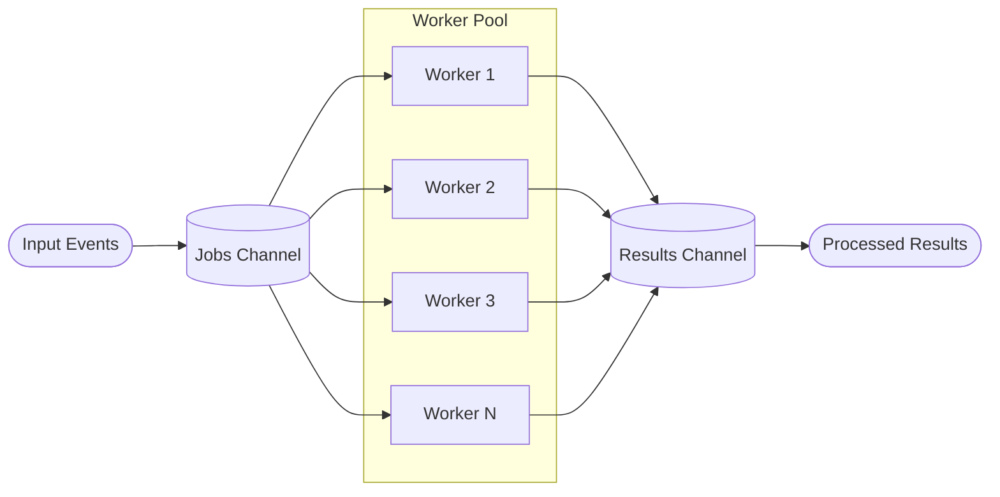
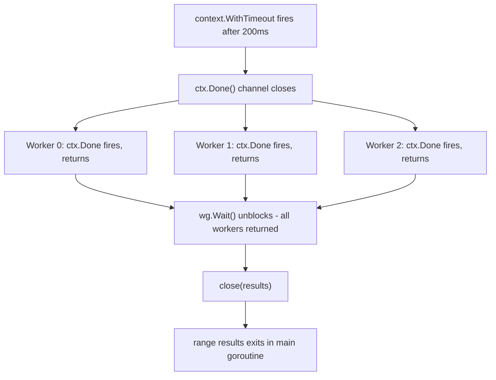

Imagine you have 100,000 events arriving and you need to process every one of them. The naive approach is to spin up a goroutine for each one:

```go
for _, event := range events {
    go process(event)
}
```

This works fine for 100 events. For 100,000, you spawn 100,000 goroutines simultaneously. Each goroutine needs stack memory. They all try to hit the same database or API at the same time. The database rejects connections. The OS scheduler bogs down. Your service crashes or grinds to a halt.

The fix is a **worker pool**: a fixed number of goroutines that all read from the same channel. You control how many workers exist. You control how much work queues up. The system stays stable regardless of how many events arrive.

This post builds that system from scratch. Every design decision is explained. Every tricky part is shown with code that actually runs.

## The Core Idea

A worker pool has three parts:



1. A **jobs channel** holds work waiting to be done.
2. A **fixed set of workers** (goroutines) each read from that channel in a loop.
3. A **results channel** (or error channel) collects what each worker produces.

Only N workers run at any moment, where N is a number you choose. If new work arrives faster than workers can process it, the jobs channel fills up and the producer blocks or is told to wait. This is called **backpressure**. It is not a bug; it is a feature. It is how you prevent the system from being overwhelmed.

## A Minimal Running Example

Before layering on error handling, cancellation, and ordering, here is the simplest possible worker pool. Read it carefully.

```go title="pool_basic.go"
package main

import (
	"fmt"
	"sync"
)

func main() {
	jobs := make(chan int, 100) // buffered: producer can get ahead a little
	var wg sync.WaitGroup

	// Start 5 workers.
	for w := 0; w < 5; w++ {
		wg.Add(1)
		go func(id int) {
			defer wg.Done()
			for job := range jobs { // blocks until a job arrives, exits when channel closes
				fmt.Printf("worker %d processing job %d\n", id, job)
			}
		}(w)
	}

	// Send 20 jobs.
	for j := 0; j < 20; j++ {
		jobs <- j
	}
	close(jobs) // signal workers: no more jobs

	wg.Wait() // wait for all workers to finish
	fmt.Println("done")
}
```

Run this and you will see 20 lines printed in some order. The order is non-deterministic because the scheduler decides which worker picks up each job.

Three things to understand here:

**`for job := range jobs` is the key loop.** When the channel has a value, the loop body runs. When the channel is empty, the goroutine blocks (waits) without burning CPU. When the channel is closed and empty, the loop exits. This is how workers know they are done without any extra signaling.

**`close(jobs)` is the shutdown signal.** Closing a channel does not delete its values. Buffered jobs drain first, then the range loop exits in each worker. Never close a channel from multiple goroutines; only the producer (the one sending jobs) should close it.

**`wg.Wait()` prevents the program from exiting before all workers finish.** Without it, `main` returns and the Go runtime kills all goroutines mid-work.

## Why You Bound the Number of Workers

Without a pool, you create one goroutine per event:

```
100,000 events -> 100,000 goroutines
```

Each goroutine starts with 2KB of stack memory (Go 1.4 reduced this from 8KB; it grows as needed). At 100,000 goroutines that is roughly 200MB minimum just for stacks, before any work is done. If each goroutine makes a database query, you get 100,000 simultaneous database connections. Most databases cap at a few hundred or a few thousand. They reject the rest. You get a flood of errors right when load is highest.

With a pool of N workers:

```
100,000 events -> N goroutines (you choose N)
```

If N is 20, you make at most 20 database calls at once. The database is comfortable. The 99,980 other events wait in the channel. They get processed one by one as workers become free. Total time is roughly `(100,000 events * avg processing time) / N workers`. Adding more workers reduces total time, up to the point where the database becomes the bottleneck.

A common starting point: N equals the number of CPU cores for CPU-bound work, or the database connection pool size for I/O-bound work.

## Handling Errors

The basic pool above ignores errors. Real work fails. Here is how to collect errors from workers.

The pattern: each worker sends its result (success or error) to a results channel. The main goroutine reads results and accumulates errors.

Each snippet from here on is a self-contained `package main` program. They each define their own `Result` type with the fields that section needs, so the shapes differ between snippets.

```go title="pool_with_errors.go"
package main

import (
	"errors"
	"fmt"
	"sync"
)

type Result struct {
	JobID int
	Value string
	Err   error
}

func process(jobID int) (string, error) {
	if jobID%7 == 0 {
		return "", fmt.Errorf("job %d failed: value is divisible by 7", jobID)
	}
	return fmt.Sprintf("processed-%d", jobID), nil
}

func runPool(numWorkers int, jobs []int) []Result {
	jobCh := make(chan int, len(jobs))
	resultCh := make(chan Result, len(jobs))

	var wg sync.WaitGroup

	for w := 0; w < numWorkers; w++ {
		wg.Add(1)
		go func() {
			defer wg.Done()
			for jobID := range jobCh {
				val, err := process(jobID)
				resultCh <- Result{JobID: jobID, Value: val, Err: err}
			}
		}()
	}

	// Send all jobs.
	for _, j := range jobs {
		jobCh <- j
	}
	close(jobCh)

	// Wait for workers, then close results so we can range over it.
	go func() {
		wg.Wait()
		close(resultCh)
	}()

	// Collect results.
	var results []Result
	for r := range resultCh {
		results = append(results, r)
	}
	return results
}

func main() {
	jobs := make([]int, 50)
	for i := range jobs {
		jobs[i] = i
	}

	results := runPool(5, jobs)

	var errs []error
	for _, r := range results {
		if r.Err != nil {
			errs = append(errs, r.Err)
		}
	}

	fmt.Printf("processed: %d, errors: %d\n", len(results)-len(errs), len(errs))
	fmt.Println(errors.Join(errs...))
}
```

There is one important detail: `close(resultCh)` happens in a separate goroutine, after `wg.Wait()`. Why? Because both the workers and the result collector run concurrently. If you called `wg.Wait()` in the main goroutine before ranging over `resultCh`, you would deadlock: main blocks waiting for workers, but workers block trying to send to `resultCh` because nobody is reading it yet.

The pattern is always: close the output channel in a goroutine that waits for workers, then range over the output channel in the caller.

## What Happens When Workers Are Slower Than the Producer

When your producer sends jobs faster than workers can process them, the jobs channel fills up.

```
Producer: sending 1000 jobs/second
Workers:  processing 100 jobs/second

After 1 second: channel has ~900 jobs backed up
After 10 seconds: channel is full
```

Once the channel is full, the send operation blocks:

```go
jobCh <- job // blocks here when channel is full
```

This is backpressure. The producer slows down naturally. It cannot push more work than the workers can handle.

The channel buffer size controls how much work can queue before backpressure kicks in. A buffer of 100 means the producer can get 100 jobs ahead before it blocks.

```mermaid
flowchart TD
    subgraph zero ["Buffer = 0 (unbuffered)"]
        Z1[Producer blocks immediately if no worker is ready]
        Z2[Zero latency between job creation and pickup]
        Z3[Best when producer and workers run at similar rates]
        Z1 --> Z2 --> Z3
    end

    subgraph hundred ["Buffer = 100"]
        H1[Producer can burst 100 jobs before blocking]
        H2[Smooths out short spikes]
        H3[Most common choice]
        H1 --> H2 --> H3
    end

    subgraph full ["Buffer = len(all jobs)"]
        F1[Producer never blocks]
        F2[All jobs loaded upfront]
        F3[Only use when total size is known in advance]
        F1 --> F2 --> F3
    end
```



You can also choose to drop jobs rather than block. Use a select with a default:

```go
select {
case jobCh <- job:
    // job queued
default:
    // channel full, drop job or record metric
    droppedJobs.Inc()
}
```

Only drop jobs if losing some is acceptable. For event processing where every event must be handled, use blocking sends and let backpressure slow the producer.

## Cancellation

What if you want to stop the whole pool early? Maybe a deadline expires, or the user cancels the request, or one critical job fails and there is no point continuing.

Go's `context` package is the standard way to propagate cancellation. Every worker checks `ctx.Done()` and exits when it fires.

```go title="pool_with_cancel.go"
package main

import (
	"context"
	"fmt"
	"sync"
	"time"
)

type Job struct {
	ID int
}

type Result struct {
	JobID int
	Value int
}

func worker(ctx context.Context, id int, jobs <-chan Job, results chan<- Result, wg *sync.WaitGroup) {
	defer wg.Done()

	for {
		select {
		case <-ctx.Done():
			fmt.Printf("worker %d: context cancelled, stopping\n", id)
			return
		case job, ok := <-jobs:
			if !ok {
				return // channel closed, no more jobs
			}
			// Simulate work that also respects cancellation.
			select {
			case <-ctx.Done():
				return
			case <-time.After(50 * time.Millisecond):
			}
			// Send result, but also respect cancellation so the goroutine
			// does not block forever if the reader exits early.
			select {
			case results <- Result{JobID: job.ID, Value: job.ID * 2}:
			case <-ctx.Done():
				return
			}
		}
	}
}

func main() {
	ctx, cancel := context.WithTimeout(context.Background(), 200*time.Millisecond)
	defer cancel()

	jobs := make(chan Job, 100)
	results := make(chan Result, 100)
	var wg sync.WaitGroup

	for w := 0; w < 3; w++ {
		wg.Add(1)
		go worker(ctx, w, jobs, results, &wg)
	}

	// Send 20 jobs (some will not be processed before timeout).
	for i := 0; i < 20; i++ {
		jobs <- Job{ID: i}
	}
	close(jobs)

	go func() {
		wg.Wait()
		close(results)
	}()

	var processed []Result
	for r := range results {
		processed = append(processed, r)
	}

	fmt.Printf("processed %d of 20 jobs before timeout\n", len(processed))
}
```

How cancellation flows through this system:



The `select` with two cases is the core pattern:

```go
select {
case <-ctx.Done():
    return // cancellation wins
case job, ok := <-jobs:
    // process job
}
```

If both `ctx.Done()` and `jobs` are ready at the same moment, Go picks one at random. This is fine. The important property is that cancellation is always checked, not ignored.

Pass contexts through your call stack so every long-running operation respects cancellation:

```go
// Pass ctx to database calls, HTTP requests, etc.
result, err := db.QueryContext(ctx, query, args...)

req, _ := http.NewRequestWithContext(ctx, "GET", url, nil)
resp, err := http.DefaultClient.Do(req)
```

When the context is cancelled, `db.QueryContext` and `http.DefaultClient.Do` return immediately with an error. Your worker gets the error, sees `ctx.Err() != nil`, and exits cleanly.

## How to Avoid Goroutine Leaks

A goroutine leak happens when a goroutine is still running after the work it was doing is no longer needed. Leaked goroutines hold memory and may hold file handles, database connections, or other resources.

The most common cause in worker pools: nobody closes the jobs channel, so workers block on `range jobs` forever.

```go
// BUG: workers leak if done is never closed.
func leakyPool() {
    jobs := make(chan int)
    for w := 0; w < 5; w++ {
        go func() {
            for job := range jobs { // blocks forever
                _ = job
            }
        }()
    }
    // forgot to close(jobs)
}
```

Rules to avoid leaks:

**Rule 1: The producer always closes the jobs channel.**

```go
// Good: producer closes when done sending.
go func() {
    defer close(jobs)
    for _, j := range allJobs {
        jobs <- j
    }
}()
```

**Rule 2: Use context cancellation as a second exit path.**

Even if you forget to close the channel, workers exit when the context is cancelled:

```go
for {
    select {
    case <-ctx.Done():
        return // guaranteed exit
    case job, ok := <-jobs:
        if !ok {
            return
        }
        process(job)
    }
}
```

**Rule 3: Never block on a send to an unbuffered results channel without a context check.**

```go
// BUG: blocks forever if the results reader exits early.
results <- someValue

// Good: also listen for cancellation.
select {
case results <- someValue:
case <-ctx.Done():
    return
}
```

**Rule 4: Use `goleak` in tests** to catch leaks before they reach production.

```go
import "go.uber.org/goleak"

func TestMyPool(t *testing.T) {
    defer goleak.VerifyNone(t)
    // run your pool
}
```

`goleak` checks that no goroutines started during the test are still running when the test ends. If any leaked, the test fails with their stack traces.

## Do Results Have to Be Ordered?

By default, no. Workers run concurrently. Job 0 may finish after job 5. The results channel receives them in whatever order workers complete.

```
Jobs sent:    0, 1, 2, 3, 4
Workers:      3 workers
Results may arrive: 2, 0, 4, 1, 3   (any order)
```

Often this is fine. You just need all 100,000 events processed; you do not care in what order.

When order matters, you have two options.

**Option A: Sort after collecting.**

Simple. Collect all results, then sort by job ID (requires `import "sort"`):

```go
sort.Slice(results, func(i, j int) bool {
    return results[i].JobID < results[j].JobID
})
```

Works well when all results fit in memory and you do not need to stream them.

**Option B: Preserve order with an index buffer.**

If you need results in order as they arrive (streaming, pipeline stages), use an output buffer:

```go title="ordered_pool.go"
package main

import (
	"fmt"
	"sync"
)

type Job struct {
	Index int
	Value string
}

type Result struct {
	Index int
	Value string
}

func runOrderedPool(numWorkers int, jobs []Job) []Result {
	jobCh := make(chan Job, len(jobs))
	resultCh := make(chan Result, len(jobs))

	var wg sync.WaitGroup
	for w := 0; w < numWorkers; w++ {
		wg.Add(1)
		go func() {
			defer wg.Done()
			for job := range jobCh {
				// Each result carries its original index.
				resultCh <- Result{
					Index: job.Index,
					Value: fmt.Sprintf("done-%s", job.Value),
				}
			}
		}()
	}

	for _, j := range jobs {
		jobCh <- j
	}
	close(jobCh)

	go func() {
		wg.Wait()
		close(resultCh)
	}()

	// Reassemble in original order.
	ordered := make([]Result, len(jobs))
	for r := range resultCh {
		ordered[r.Index] = r
	}
	return ordered
}

func main() {
	jobs := []Job{
		{Index: 0, Value: "alpha"},
		{Index: 1, Value: "beta"},
		{Index: 2, Value: "gamma"},
		{Index: 3, Value: "delta"},
	}

	results := runOrderedPool(3, jobs)
	for _, r := range results {
		fmt.Printf("%d: %s\n", r.Index, r.Value)
	}
}
```

Each job carries its original index. Each result carries the same index. When you collect results, you place them directly at `ordered[r.Index]`. The output slice is always in input order, regardless of what order workers finished.

The memory cost: you hold all results in memory until the last one arrives. For 100,000 events that is usually fine.

## Clean Shutdown

Shutdown means: stop accepting new work, finish work in progress, then exit cleanly.

Here is a complete, production-ready pool with clean shutdown:

```go title="pool_complete.go"
package main

import (
	"context"
	"errors"
	"fmt"
	"sync"
	"time"
)

type Event struct {
	ID   int
	Data string
}

type ProcessResult struct {
	EventID int
	Output  string
	Err     error
}

// Pool is a fixed-size worker pool.
type Pool struct {
	workers int
	jobCh   chan Event
	resCh   chan ProcessResult
	wg      sync.WaitGroup
}

// NewPool creates a pool with the given number of workers and job buffer.
func NewPool(workers, bufferSize int) *Pool {
	return &Pool{
		workers: workers,
		jobCh:   make(chan Event, bufferSize),
		resCh:   make(chan ProcessResult, bufferSize),
	}
}

// Start launches workers and returns a channel of results.
// The results channel closes when all workers finish.
func (p *Pool) Start(ctx context.Context) <-chan ProcessResult {
	for i := 0; i < p.workers; i++ {
		p.wg.Add(1)
		go p.work(ctx)
	}

	go func() {
		p.wg.Wait()
		close(p.resCh)
	}()

	return p.resCh
}

func (p *Pool) work(ctx context.Context) {
	defer p.wg.Done()

	for {
		select {
		case <-ctx.Done():
			return
		case event, ok := <-p.jobCh:
			if !ok {
				return
			}
			output, err := processEvent(ctx, event)
			select {
			case p.resCh <- ProcessResult{EventID: event.ID, Output: output, Err: err}:
			case <-ctx.Done():
				return
			}
		}
	}
}

// Submit sends an event to the pool. Blocks if the job buffer is full.
// Returns an error if the context is cancelled before the job is accepted.
func (p *Pool) Submit(ctx context.Context, event Event) error {
	select {
	case p.jobCh <- event:
		return nil
	case <-ctx.Done():
		return ctx.Err()
	}
}

// Stop signals workers to stop accepting new jobs and waits for them to finish.
func (p *Pool) Stop() {
	close(p.jobCh)
	p.wg.Wait()
}

func processEvent(ctx context.Context, event Event) (string, error) {
	// Simulate I/O with a short sleep that respects cancellation.
	select {
	case <-ctx.Done():
		return "", ctx.Err()
	case <-time.After(10 * time.Millisecond):
	}

	if event.ID%100 == 0 {
		return "", fmt.Errorf("event %d: processing failed", event.ID)
	}

	return fmt.Sprintf("output for event %d: %s", event.ID, event.Data), nil
}

func main() {
	ctx, cancel := context.WithTimeout(context.Background(), 5*time.Second)
	defer cancel()

	pool := NewPool(10, 500) // 10 workers, buffer 500 jobs
	results := pool.Start(ctx)

	// Producer goroutine: sends 1000 events and closes when done.
	go func() {
		defer pool.Stop() // closes jobCh, signals workers to finish
		for i := 0; i < 1000; i++ {
			event := Event{ID: i, Data: fmt.Sprintf("data-%d", i)}
			if err := pool.Submit(ctx, event); err != nil {
				// Context cancelled. Stop sending.
				fmt.Printf("producer stopping: %v\n", err)
				return
			}
		}
	}()

	// Collect results.
	var processed, failed int
	var errs []error
	for r := range results {
		if r.Err != nil {
			failed++
			errs = append(errs, r.Err)
		} else {
			processed++
		}
	}

	fmt.Printf("processed: %d, failed: %d\n", processed, failed)
	if len(errs) > 0 {
		fmt.Printf("first error: %v\n", errs[0])
		fmt.Printf("all errors: %v\n", errors.Join(errs...))
	}
}
```

Trace the shutdown sequence:

```mermaid
flowchart TD
    subgraph normal ["Normal Shutdown"]
        A1["Producer sends all 1000 jobs"] --> A2["pool.Stop() closes jobCh"]
        A2 --> A3["Workers see channel closed, return"]
        A3 --> A4["wg.Wait() unblocks"]
        A4 --> A5["close(resCh) fires"]
        A5 --> A6["range results in main exits"]
        A6 --> A7["main prints stats and exits"]
    end

    subgraph timeout ["Context Timeout Path"]
        B1["ctx.Done() fires in all workers"] --> B2["Workers return from ctx.Done() select case"]
        B2 --> B3["wg.Wait() unblocks"]
        B3 --> B4["close(resCh) fires"]
        B4 --> B5["range results in main exits"]
    end
```



Both paths lead to the same clean exit. The goroutine that closes `resCh` only runs after all workers are done, so `range results` always gets a fully drained channel.

## Stop on First Error

Sometimes you want to cancel everything the moment any worker fails. `errgroup` from the extended standard library handles this pattern:

```go title="pool_errgroup.go"
package main

import (
	"context"
	"fmt"

	"golang.org/x/sync/errgroup"
)

func processWithErrGroup(ctx context.Context, events []int) error {
	g, ctx := errgroup.WithContext(ctx)

	jobs := make(chan int, len(events))
	for _, e := range events {
		jobs <- e
	}
	close(jobs)

	for w := 0; w < 10; w++ {
		g.Go(func() error {
			for {
				select {
				case <-ctx.Done():
					return ctx.Err()
				case job, ok := <-jobs:
					if !ok {
						return nil
					}
					if err := doWork(ctx, job); err != nil {
						return err // cancels all other workers via ctx
					}
				}
			}
		})
	}

	return g.Wait()
}

func doWork(ctx context.Context, job int) error {
	if job == 42 {
		return fmt.Errorf("job 42 is forbidden")
	}
	return nil
}

func main() {
	events := make([]int, 100)
	for i := range events {
		events[i] = i
	}

	if err := processWithErrGroup(context.Background(), events); err != nil {
		fmt.Printf("pool stopped with error: %v\n", err)
	}
}
```

`errgroup.WithContext` returns a derived context that is cancelled as soon as any goroutine passed to `g.Go` returns a non-nil error. All other workers see `ctx.Done()` close and exit.

`g.Wait()` returns the first error that caused cancellation. All other errors are discarded (only one is returned). If you need all errors, collect them in a slice with a mutex and use plain `sync.WaitGroup`.

## Putting It All Together: 100,000 Events

Here is a realistic program that processes 100,000 events with a worker pool, collects all errors, respects cancellation, and prints a summary:

```go title="main.go"
package main

import (
	"context"
	"errors"
	"fmt"
	"math/rand"
	"sync"
	"time"
)

type Event struct {
	ID   int
	Data string
}

type Result struct {
	EventID int
	Err     error
}

func processEvent(ctx context.Context, event Event) error {
	// Simulate variable processing time.
	delay := time.Duration(rand.Intn(5)) * time.Millisecond
	select {
	case <-ctx.Done():
		return ctx.Err()
	case <-time.After(delay):
	}

	// Simulate a 1% error rate.
	if rand.Intn(100) == 0 {
		return fmt.Errorf("event %d: transient failure", event.ID)
	}

	return nil
}

func runPool(ctx context.Context, numWorkers int, events []Event) []Result {
	jobCh := make(chan Event, 1000)
	resultCh := make(chan Result, 1000)

	var wg sync.WaitGroup
	for w := 0; w < numWorkers; w++ {
		wg.Add(1)
		go func() {
			defer wg.Done()
			for {
				select {
				case <-ctx.Done():
					return
				case event, ok := <-jobCh:
					if !ok {
						return
					}
					err := processEvent(ctx, event)
					select {
					case resultCh <- Result{EventID: event.ID, Err: err}:
					case <-ctx.Done():
						return
					}
				}
			}
		}()
	}

	// Producer.
	go func() {
		defer close(jobCh)
		for _, e := range events {
			select {
			case <-ctx.Done():
				return
			case jobCh <- e:
			}
		}
	}()

	// Close results when workers are done.
	go func() {
		wg.Wait()
		close(resultCh)
	}()

	// Collect.
	var results []Result
	for r := range resultCh {
		results = append(results, r)
	}
	return results
}

func main() {
	const numEvents = 100_000
	const numWorkers = 50

	events := make([]Event, numEvents)
	for i := range events {
		events[i] = Event{ID: i, Data: fmt.Sprintf("payload-%d", i)}
	}

	ctx, cancel := context.WithTimeout(context.Background(), 30*time.Second)
	defer cancel()

	start := time.Now()
	results := runPool(ctx, numWorkers, events)
	elapsed := time.Since(start)

	var errs []error
	for _, r := range results {
		if r.Err != nil {
			errs = append(errs, r.Err)
		}
	}

	fmt.Printf("events: %d\n", numEvents)
	fmt.Printf("workers: %d\n", numWorkers)
	fmt.Printf("processed: %d\n", len(results)-len(errs))
	fmt.Printf("failed: %d\n", len(errs))
	fmt.Printf("elapsed: %v\n", elapsed)
	fmt.Printf("throughput: %.0f events/sec\n", float64(len(results))/elapsed.Seconds())

	if len(errs) > 0 {
		fmt.Printf("\nfirst 3 errors:\n%v\n", errors.Join(errs[:min(3, len(errs))]...))
	}
}

```

This program runs in under 10 seconds on a laptop (mostly bounded by the simulated delays). The throughput scales linearly with the number of workers up to the point where the simulated work becomes the bottleneck.

## A Diagnostic Checklist

Before shipping a worker pool, run through this list:

```
Goroutine leaks
  [ ] Someone closes the jobs channel (or context cancels as backup).
  [ ] Workers have a ctx.Done() case in every blocking select.
  [ ] The results channel is closed only after all workers return.
  [ ] Tests use goleak to catch leaks automatically.

Backpressure
  [ ] Buffer size is documented and justified.
  [ ] The producer checks ctx.Done() when sending, not just the payload.
  [ ] Dropping jobs is explicit and logged (if that is the chosen behavior).

Error handling
  [ ] Every error is either returned to the caller or sent to a results channel.
  [ ] Transient errors are retried; permanent errors are logged and skipped.
  [ ] errgroup is used when one failure should cancel all workers.

Cancellation
  [ ] All long-running work (DB queries, HTTP calls) receives the context.
  [ ] ctx.Err() is checked before starting new work in a worker.

Ordering
  [ ] The comment in the code states whether order is preserved or not.
  [ ] If order matters, each job carries its original index.

Shutdown
  [ ] pool.Stop() is always called (defer it where possible).
  [ ] The results channel is fully drained before exiting.
```

## Common Mistakes

**Closing the jobs channel twice.**

Two goroutines both calling `close(jobs)` causes a panic. Only one goroutine should own the channel and be responsible for closing it.

**Sending to a closed channel.**

If a worker sends to the jobs channel after it is closed, you get a panic. The producer should be the only one sending, and it should stop before closing.

**Not draining the results channel.**

If the main goroutine exits before reading all results, workers block trying to send. They never return. `wg.Wait()` never unblocks. The program hangs.

```
WRONG:
  go func() { wg.Wait(); close(resCh) }()
  cancel() // stop workers
  // exit main without draining resCh -> workers block -> deadlock
```

Always drain the results channel, even if you only care about errors:

```go
for r := range resultCh {
    if r.Err != nil {
        errs = append(errs, r.Err)
    }
}
```

**Using a WaitGroup counter wrong.**

Call `wg.Add(1)` before starting the goroutine, not inside it. If the scheduler runs between `go func()` and `wg.Add(1)`, `wg.Wait()` might return before the goroutine starts.

```go
// WRONG
go func() {
    wg.Add(1) // too late
    defer wg.Done()
    // ...
}()

// RIGHT
wg.Add(1)
go func() {
    defer wg.Done()
    // ...
}()
```

**Passing the loop variable to goroutines without capturing it.**

In Go versions before 1.22, loop variables are shared across iterations. To catch this, run `go vet ./...` (the `loopclosure` analyzer is included by default since Go 1.20) or use the race detector with `go test -race ./...`. In Go 1.22 and later, each loop iteration has its own variable and this is no longer a problem.

```go
// Before Go 1.22: i is shared, all goroutines may see the same value.
for i := 0; i < 5; i++ {
    go func() { fmt.Println(i) }() // WRONG before 1.22
}

// Safe in all versions:
for i := 0; i < 5; i++ {
    i := i // shadow: creates a new variable for this iteration
    go func() { fmt.Println(i) }()
}
```

## Official Resources

These are worth reading in this order:

**A Tour of Go** covers goroutines and channels from scratch with interactive examples. Start here if any of the channel syntax felt unfamiliar.

**Effective Go** has a section on goroutines and channels that explains the design philosophy: goroutines are cheap, channels are the preferred communication mechanism, and the rule "do not communicate by sharing memory; share memory by communicating" is more than a slogan.

**Go: Data Race Detector** shows how to run `go test -race ./...` and interpret its output. Run this on every worker pool you write. The race detector finds bugs that are invisible in normal tests.

**Go Concurrency Patterns: Pipelines and cancellation** (Go blog, 2014) is where many of the patterns in this post come from. It shows how to compose channels into pipelines and how to use `done` channels (the predecessor to `context`) for cancellation.

## Summary

A worker pool lets you process large volumes of work concurrently without crashing your system.

The pattern:
1. Create a jobs channel (buffered for smoothing, unbuffered for strict backpressure).
2. Start N worker goroutines, each ranging over the jobs channel.
3. The producer sends jobs and closes the channel when done.
4. Workers send results to a results channel.
5. A separate goroutine calls `wg.Wait()` and then closes the results channel.
6. The caller ranges over the results channel until it closes.

Bounded concurrency comes from the fixed number of workers. Backpressure comes from the channel buffer filling up. Cancellation propagates through a context passed to every worker and every long-running call inside each worker. Errors go through the results channel or `errgroup`. Goroutine leaks are prevented by always closing the jobs channel and always having a `ctx.Done()` exit path. Ordering is opt-in: tag each job with an index and place results at that index in an output slice. Shutdown is always the same: close the jobs channel, wait for workers, close the results channel.

Master these seven properties and you can process any volume of work safely, regardless of how fast events arrive.
