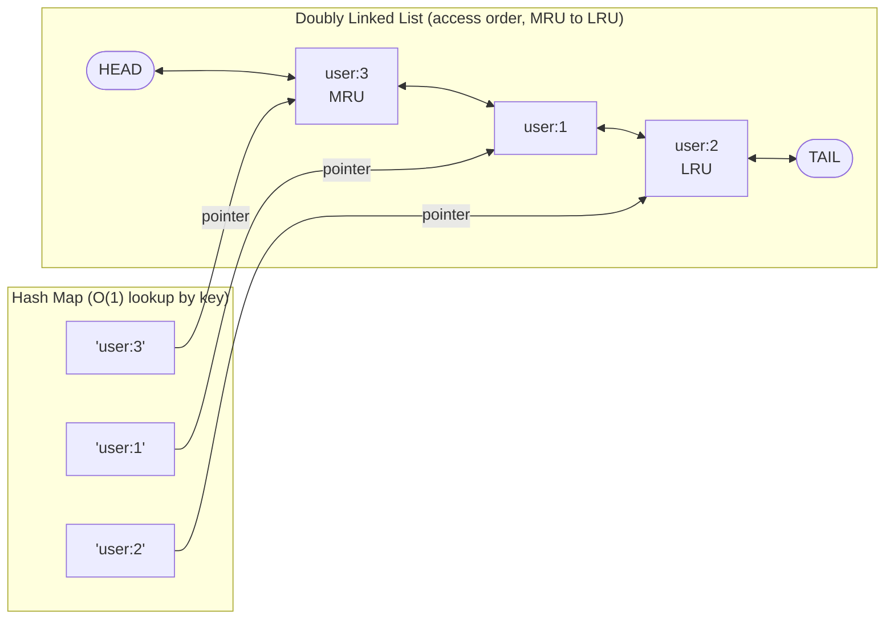
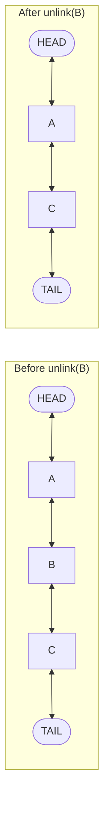

Fetching data is expensive. A database query that takes 10ms done once is fine. Done 10,000 times per second for the same user record, it is a bottleneck. A cache solves this by keeping recently used results in memory so the expensive fetch only happens once.

But a basic cache has two problems. First, memory is finite. When the cache fills up, something must be removed. Which entry do you evict? Second, cached data goes stale. A user record cached at 10:00 may be wrong by 10:05 if someone updated it. How do you stop stale data from lingering?

An LRU cache with TTL solves both problems. LRU (Least Recently Used) answers the eviction question: evict the entry that was accessed least recently. TTL (Time To Live) answers the staleness question: each entry carries an expiry time, and once it passes, the entry is treated as gone.

Every data structure choice is explained with the reason behind it. Every tricky part is shown with code that runs. The complete Go implementation is thread-safe.

## Two Problems, Two Mechanisms

Before writing any code, here is what the system needs to do.

**Eviction policy (LRU).** When the cache is full and you add a new entry, something must go. LRU evicts the entry that has gone the longest without being accessed. The intuition: if you have not needed something recently, you are unlikely to need it soon.

Other eviction policies exist:
- LFU (Least Frequently Used): evict the entry accessed the fewest total times. Better when the same entries are accessed over and over for a long time, worse when popularity changes quickly.
- FIFO (First In First Out): evict the oldest entry by insertion time. Simple but ignores how often entries are accessed.
- Random: evict a random entry. Surprisingly competitive in some CPU caches, but unpredictable for application-level use.

LRU strikes the best balance for general web application caching.

**Expiry policy (TTL).** Each entry has a deadline. After that deadline, the entry is invalid. When a Get request arrives for an expired entry, return "not found" and remove it. When no one accesses an expired entry, a background process eventually cleans it up.

These two mechanisms interact in a way that is easy to get wrong. An expired entry still occupies a slot in the cache. If the cache fills up with expired entries, new writes will evict valid entries instead of the expired ones. A good design handles this correctly.

## Why HashMap Plus Doubly Linked List

An LRU cache needs two operations, both in O(1) time:
1. **Get(key):** find the entry and mark it as most recently used
2. **Put(key, value):** add an entry; if full, remove the least recently used entry first

Work through what each operation needs:
- Fast lookup by key: O(1). That is a hash map.
- Maintain an ordered list where the most recently used entry is always at the front: O(1) to move any node to the front. That is a doubly linked list.
- Find and remove the least recently used entry: O(1). That is the tail of the doubly linked list.

Neither data structure alone is enough. A hash map has no order. A linked list has no fast lookup by key. Together, they satisfy every requirement.



The hash map stores pointers to nodes in the list. The list keeps nodes in access order, most recently used at the front, least recently used at the back. When you Get a key, the hash map finds the node in O(1), and the list moves it to the front in O(1) because you already have direct pointers to the node's neighbors.

HEAD and TAIL are placeholder nodes that never hold real data. They sit at both ends of the list so that insert and remove operations never need to handle the "empty list" case specially.

## The Node

A node is the unit of storage. It lives in both the hash map and the doubly linked list at the same time.

```go title="cache/cache.go"
package cache

import "time"

type node[K comparable, V any] struct {
	key    K
	value  V
	expiry time.Time  // zero value means no TTL
	prev   *node[K, V]
	next   *node[K, V]
}

func (n *node[K, V]) isExpired() bool {
	return !n.expiry.IsZero() && time.Now().After(n.expiry)
}
```

Generics (`[K comparable, V any]`) let the same code work for any key and value types. Without them you would have to cast values to a specific type every time you read from the cache. `K comparable` is required because map keys must support `==`.

The `expiry` field stores an absolute time, not a duration. Storing an absolute time means the check is always `time.Now().After(n.expiry)`, regardless of when the entry was inserted. If you stored a duration, you would need to also store the insertion time and compute the expiry each time. Absolute time is simpler and faster.

A zero `expiry` means no TTL. `isExpired` returns false for these entries, so they live until evicted by the LRU policy.

The node stores the `key` as well as the value. This seems redundant since the key is also in the hash map, but it is necessary. When `evictLRU` removes the tail node from the list, it needs the key to delete the corresponding entry from the hash map. Without `key` in the node, there is no way to find the map entry in O(1).

## The Cache Type

```go title="cache/cache.go"
package cache

import (
	"sync"
	"time"
)

// LRUCache is a thread-safe cache with LRU eviction and optional per-entry TTL.
type LRUCache[K comparable, V any] struct {
	cap        int
	mu         sync.Mutex
	closeOnce  sync.Once  // prevents double-close panic on c.done
	items      map[K]*node[K, V]
	head       *node[K, V] // placeholder: MRU boundary
	tail       *node[K, V] // placeholder: LRU boundary
	done       chan struct{}
}

// New creates an LRU cache with the given capacity.
// If cleanupInterval is positive, a background goroutine runs at that interval
// to remove expired entries proactively. Call Close to stop it.
func New[K comparable, V any](capacity int, cleanupInterval time.Duration) *LRUCache[K, V] {
	if capacity <= 0 {
		panic("cache: capacity must be positive")
	}
	head := &node[K, V]{}
	tail := &node[K, V]{}
	head.next = tail
	tail.prev = head
	c := &LRUCache[K, V]{
		cap:   capacity,
		items: make(map[K]*node[K, V], capacity),
		head:  head,
		tail:  tail,
		done:  make(chan struct{}),
	}
	if cleanupInterval > 0 {
		c.startCleanup(cleanupInterval)
	}
	return c
}
```

The placeholder nodes are connected at construction: `head.next = tail`, `tail.prev = head`. All real entries go between them. The list always has at least these two nodes, so there is never a truly empty list to handle as a special case.

`startCleanup` launches a background goroutine that periodically removes expired entries. We will define it in the [Background Cleanup Goroutine](#the-background-cleanup-goroutine) section below.

## Three Core List Operations

All LRU logic reduces to three operations on the doubly linked list. Everything else is built on top of these.

**Unlink: remove a node from wherever it sits in the list.**

```go title="cache/cache.go"
func (c *LRUCache[K, V]) unlink(n *node[K, V]) {
	next := n.next
	prev := n.prev

	prev.next = next
	next.prev = prev
}
```

Before and after for `unlink(B)` in `HEAD <-> A <-> B <-> C <-> TAIL`:



**Push front: insert a node right after HEAD (mark as most recently used).**

```go title="cache/cache.go"
func (c *LRUCache[K, V]) pushFront(n *node[K, V]) {
	next := c.head.next

	c.head.next = n
	n.prev = c.head

	n.next = next
	next.prev = n
}
```

Tracing through `pushFront(N)` with list `HEAD <-> A <-> TAIL`:

```
Step 1: next = HEAD.next    (save the current front node, A)
Step 2: HEAD.next = N       (HEAD now points to N)
Step 3: N.prev = HEAD       (N's left neighbor is HEAD)
Step 4: N.next = next       (N's right neighbor is A)
Step 5: next.prev = N       (A's left neighbor is now N)
Result: HEAD <-> N <-> A <-> TAIL
```

**Evict LRU: remove the node just before TAIL.**

```go title="cache/cache.go"
func (c *LRUCache[K, V]) evictLRU() {
	lru := c.tail.prev
	if lru == c.head {
		return // empty list, nothing to evict
	}
	c.unlink(lru)
	delete(c.items, lru.key)
}
```

The LRU entry is always `tail.prev`. Unlinking it and removing it from the map takes O(1) time.

## Get

```go title="cache/cache.go"
// Get returns the value for key and true, or the zero value and false if the key
// is absent or expired. A found, non-expired entry is moved to the MRU position.
func (c *LRUCache[K, V]) Get(key K) (V, bool) {
	c.mu.Lock()
	defer c.mu.Unlock()

	n, ok := c.items[key]
	if !ok {
		var zero V
		return zero, false
	}

	if n.isExpired() {
		c.unlink(n)
		delete(c.items, key)
		var zero V
		return zero, false
	}

	c.unlink(n)
	c.pushFront(n)
	return n.value, true
}
```

Get does two things. If the entry exists but is expired, it removes it right away and returns "not found". This is called **lazy deletion**: clean up an expired entry only when someone tries to read it, not before. As far as the caller is concerned, an expired entry does not exist. If the entry is still valid, it moves to the front of the list. That is the LRU update: every access marks the entry as most recently used.

Without lazy deletion, an expired entry would be returned as a valid result, which is wrong. With it, the first Get after expiry cleans up the entry for free.

## Put

```go title="cache/cache.go"
// Put adds or updates an entry. ttl is the duration the entry stays valid.
// A ttl of zero means the entry has no expiry.
func (c *LRUCache[K, V]) Put(key K, value V, ttl time.Duration) {
	c.mu.Lock()
	defer c.mu.Unlock()

	if n, ok := c.items[key]; ok {
		n.value = value
		if ttl > 0 {
			n.expiry = time.Now().Add(ttl)
		} else {
			n.expiry = time.Time{}
		}
		c.unlink(n)
		c.pushFront(n)
		return
	}

	if len(c.items) >= c.cap {
		c.evictLRU()
	}

	n := &node[K, V]{key: key, value: value}
	if ttl > 0 {
		n.expiry = time.Now().Add(ttl)
	}
	c.items[key] = n
	c.pushFront(n)
}
```

If the key already exists, the entry is updated in place. The node is not replaced; its value and TTL are updated and it moves to the front. Calling `Put` on an existing key extends the TTL without pushing out any other entry or changing `Len`.

If the key is new and the cache is at capacity, `evictLRU` removes the least recently used entry first. Then the new node is created and inserted.

One thing to notice about updating: when you re-put a key with no TTL (`ttl == 0`), the existing TTL is cleared. This prevents an entry from silently keeping an old expiry that is no longer relevant.

## Delete and Len

```go title="cache/cache.go"
func (c *LRUCache[K, V]) Delete(key K) {
	c.mu.Lock()
	defer c.mu.Unlock()

	n, ok := c.items[key]
	if !ok {
		return
	}
	c.unlink(n)
	delete(c.items, key)
}

func (c *LRUCache[K, V]) Len() int {
	c.mu.Lock()
	defer c.mu.Unlock()
	return len(c.items)
}
```

`Len` counts all entries including expired ones that have not been lazily removed yet. This is a minor inconsistency: `Get` treats expired entries as absent, but `Len` counts them. If your code depends on `Len` reflecting only valid entries, run the cleanup goroutine frequently or add an explicit expiry check in `Len`. For most uses, the slight overcount is acceptable.

## Time and Space Complexity

Here is the complete complexity picture for all operations, with the reason for each.

| Operation | Time | Why |
|-----------|------|-----|
| `Get` | O(1) | Hash map lookup; doubly linked list unlink + push-front each touch a fixed number of pointers |
| `Put` (update existing key) | O(1) | Same as Get: map lookup, in-place field update, unlink + push-front |
| `Put` (new key, cache not full) | O(1) | Map insert; push-front |
| `Put` (new key, cache full) | O(1) | `evictLRU` reads `tail.prev`, unlinks it, deletes from map; then map insert + push-front |
| `Delete` | O(1) | Map lookup; unlink + map delete |
| `Len` | O(1) | Go's built-in `len(map)` is O(1) |
| `deleteExpired` (cleanup scan) | O(n) | Must inspect every entry to find expired ones; n is the current number of entries |
| `deleteExpired` with min-heap | O(k log n) | k is the number of expired entries; heap pop is O(log n) |

**Space complexity:** O(capacity). The map and doubly linked list each hold at most `capacity` nodes. Each node stores the key, value, expiry time, and two pointers. The hash map stores one pointer per entry. Total memory scales linearly with the number of entries, bounded by capacity.

Every public operation except the cleanup scan is O(1). That is what makes this data structure worth the added complexity over a plain map. The cleanup goroutine is the only part that gets slower as the cache fills up, and it runs in the background on a timer rather than slowing down Get and Put.

## The Problem with Lazy-Only TTL

Lazy deletion is correct: an expired entry is never returned to callers. But it has a memory problem.

Entries that are written and never read again will sit in the cache until the LRU policy eventually evicts them. If you write many entries quickly and they expire before anyone reads them, the cache fills with dead weight. Valid entries get pushed out to make room for entries that will never be useful again.

A concrete scenario:

```
Cache capacity: 1,000
Workload: job queue where each job ID is put once, never read again, TTL 60s

After 60 seconds: all 1,000 entries are expired.
New entries arrive: LRU evicts... expired entries (they are the LRU).
Result: works fine here because LRU and expired happen to coincide.

But if jobs are put frequently and cache is small:
After 10 seconds: cache has 1,000 entries, all from the last 10 seconds.
900 were accessed once at put-time, never again.
100 are actively being read.
LRU evicts the 900 not-read entries before the 100 active ones.
No bug, but those 900 expired entries are holding slots that could be reclaimed sooner.
```

The fix is a background cleanup goroutine that proactively removes expired entries.

## The Background Cleanup Goroutine

A cleanup goroutine runs periodically and removes all expired entries in one pass. The interval should be proportional to your TTL. For a 60-second TTL, running every 10 seconds is reasonable. For a 10-minute TTL, running every 2 minutes is reasonable. There is no universal rule; tune it based on how quickly you want stale memory freed.

```go title="cache/cache.go"
func (c *LRUCache[K, V]) startCleanup(interval time.Duration) {
	ticker := time.NewTicker(interval)
	go func() {
		for {
			select {
			case <-ticker.C:
				c.deleteExpired()
			case <-c.done:
				ticker.Stop()
				return
			}
		}
	}()
}

func (c *LRUCache[K, V]) deleteExpired() {
	c.mu.Lock()
	defer c.mu.Unlock()

	for key, n := range c.items {
		if n.isExpired() {
			c.unlink(n)
			delete(c.items, key)
		}
	}
}

// Close stops the background cleanup goroutine. Safe to call multiple times.
func (c *LRUCache[K, V]) Close() {
	c.closeOnce.Do(func() { close(c.done) })
}
```

The `done` channel is critical. Without it, the cleanup goroutine runs forever, holding a reference to the cache. This prevents garbage collection and leaks a goroutine and memory. `Close` signals the cleanup goroutine to stop. Use `defer c.Close()` wherever you create a cache with a cleanup goroutine.

`closeOnce` wraps `close(c.done)` in a `sync.Once`. Closing an already-closed channel in Go panics. If your code ever calls `Close` a second time (a common accident when combining `defer c.Close()` with an explicit teardown call in tests), `sync.Once` absorbs it safely.

The cleanup goroutine holds the full mutex while scanning. For a cache with 100,000 entries, one scan might take a millisecond. This is typically acceptable. If you need sub-millisecond cleanup runs, use sharding (N caches, each smaller) or switch to a min-heap approach.

## Thread Safety

Every public method acquires the mutex at entry and releases it on return. The mutex is a `sync.Mutex`, not a `sync.RWMutex`.

A common mistake is to use `RWMutex` and call `RLock` for Get, since it looks like a read operation. This is wrong. Get moves the accessed node to the front of the doubly linked list. That modifies three pointer fields. Allowing two Get calls to run at the same time under `RLock` would let them corrupt each other's pointer updates.

`RWMutex` is only safe if Get does not modify the list at all. Some implementations skip the move-to-front on every Get and do it lazily in batches instead. That approach allows concurrent reads but gives approximate ordering, not exact LRU. For most applications, exact LRU with a single `Mutex` is simpler and fast enough.

Under very high traffic, many goroutines may pile up waiting for the same lock. The fix is **sharding**: split the cache into N smaller independent caches, each with its own lock. Route each key to a shard using `hash(key) % N`. Each shard handles roughly 1/N of the requests, so the wait time drops proportionally. Only add sharding if you actually measure lock wait time with pprof; do not add the complexity until you need it.

## Putting It All Together

Here is the complete, runnable implementation in a single file:

```go title="cache/cache.go"
package cache

import (
	"sync"
	"time"
)

type node[K comparable, V any] struct {
	key    K
	value  V
	expiry time.Time
	prev   *node[K, V]
	next   *node[K, V]
}

func (n *node[K, V]) isExpired() bool {
	return !n.expiry.IsZero() && time.Now().After(n.expiry)
}

type LRUCache[K comparable, V any] struct {
	cap       int
	mu        sync.Mutex
	closeOnce sync.Once
	items     map[K]*node[K, V]
	head      *node[K, V]
	tail      *node[K, V]
	done      chan struct{}
}

func New[K comparable, V any](capacity int, cleanupInterval time.Duration) *LRUCache[K, V] {
	if capacity <= 0 {
		panic("cache: capacity must be positive")
	}
	head := &node[K, V]{}
	tail := &node[K, V]{}
	head.next = tail
	tail.prev = head
	c := &LRUCache[K, V]{
		cap:   capacity,
		items: make(map[K]*node[K, V], capacity),
		head:  head,
		tail:  tail,
		done:  make(chan struct{}),
	}
	if cleanupInterval > 0 {
		c.startCleanup(cleanupInterval)
	}
	return c
}

func (c *LRUCache[K, V]) Get(key K) (V, bool) {
	c.mu.Lock()
	defer c.mu.Unlock()

	n, ok := c.items[key]
	if !ok {
		var zero V
		return zero, false
	}
	if n.isExpired() {
		c.unlink(n)
		delete(c.items, key)
		var zero V
		return zero, false
	}
	c.unlink(n)
	c.pushFront(n)
	return n.value, true
}

func (c *LRUCache[K, V]) Put(key K, value V, ttl time.Duration) {
	c.mu.Lock()
	defer c.mu.Unlock()

	if n, ok := c.items[key]; ok {
		n.value = value
		if ttl > 0 {
			n.expiry = time.Now().Add(ttl)
		} else {
			n.expiry = time.Time{}
		}
		c.unlink(n)
		c.pushFront(n)
		return
	}

	if len(c.items) >= c.cap {
		c.evictLRU()
	}

	n := &node[K, V]{key: key, value: value}
	if ttl > 0 {
		n.expiry = time.Now().Add(ttl)
	}
	c.items[key] = n
	c.pushFront(n)
}

func (c *LRUCache[K, V]) Delete(key K) {
	c.mu.Lock()
	defer c.mu.Unlock()

	n, ok := c.items[key]
	if !ok {
		return
	}
	c.unlink(n)
	delete(c.items, key)
}

func (c *LRUCache[K, V]) Len() int {
	c.mu.Lock()
	defer c.mu.Unlock()
	return len(c.items)
}

func (c *LRUCache[K, V]) Close() {
	c.closeOnce.Do(func() { close(c.done) })
}

func (c *LRUCache[K, V]) unlink(n *node[K, V]) {
	next := n.next
	prev := n.prev

	prev.next = next
	next.prev = prev
}

func (c *LRUCache[K, V]) pushFront(n *node[K, V]) {
	next := c.head.next

	c.head.next = n
	n.prev = c.head

	n.next = next
	next.prev = n
}

func (c *LRUCache[K, V]) evictLRU() {
	lru := c.tail.prev
	if lru == c.head {
		return
	}
	c.unlink(lru)
	delete(c.items, lru.key)
}

func (c *LRUCache[K, V]) deleteExpired() {
	c.mu.Lock()
	defer c.mu.Unlock()
	for key, n := range c.items {
		if n.isExpired() {
			c.unlink(n)
			delete(c.items, key)
		}
	}
}

func (c *LRUCache[K, V]) startCleanup(interval time.Duration) {
	ticker := time.NewTicker(interval)
	go func() {
		for {
			select {
			case <-ticker.C:
				c.deleteExpired()
			case <-c.done:
				ticker.Stop()
				return
			}
		}
	}()
}
```

## Running It

```go title="main.go"
package main

import (
	"fmt"
	"time"

	"yourmodule/cache"
)

func main() {
	c := cache.New[string, string](3, 5*time.Second)
	defer c.Close()

	c.Put("user:1", "Alice", 10*time.Second)
	c.Put("user:2", "Bob", 10*time.Second)
	c.Put("user:3", "Carol", 10*time.Second)

	c.Get("user:1") // user:1 is now MRU; user:2 is now LRU

	// Cache is at capacity. user:4 triggers eviction of user:2 (LRU).
	c.Put("user:4", "Dave", 10*time.Second)

	if _, ok := c.Get("user:2"); !ok {
		fmt.Println("user:2 evicted (was LRU)") // prints
	}
	if v, ok := c.Get("user:1"); ok {
		fmt.Println("user:1 still present:", v) // prints: Alice
	}

	// TTL expiry.
	c.Put("temp", "short-lived", 100*time.Millisecond)
	time.Sleep(150 * time.Millisecond)
	if _, ok := c.Get("temp"); !ok {
		fmt.Println("temp expired") // prints
	}
}
```

## Testing

Good test coverage for a cache checks the core properties and common edge cases: basic get and put, LRU eviction order, TTL expiry, no-TTL entries never expire, update resets value and TTL, cleanup goroutine proactively clears expired entries, concurrent access does not race, and boundary conditions like capacity-one caches, delete behaviour, and double-close safety.

```go title="cache/cache_test.go"
package cache_test

import (
	"fmt"
	"sync"
	"testing"
	"time"

	"yourmodule/cache"
)

func TestGetPut(t *testing.T) {
	c := cache.New[string, int](2, 0)
	defer c.Close()

	c.Put("a", 1, 0)
	v, ok := c.Get("a")
	if !ok || v != 1 {
		t.Fatalf("want (1, true), got (%d, %v)", v, ok)
	}
}

func TestMissReturnsZero(t *testing.T) {
	c := cache.New[string, int](2, 0)
	defer c.Close()

	v, ok := c.Get("missing")
	if ok || v != 0 {
		t.Fatalf("want (0, false), got (%d, %v)", v, ok)
	}
}

func TestLRUEviction(t *testing.T) {
	c := cache.New[string, int](2, 0)
	defer c.Close()

	c.Put("a", 1, 0)
	c.Put("b", 2, 0)
	c.Get("a")       // a is now MRU, b is LRU
	c.Put("c", 3, 0) // b should be evicted

	if _, ok := c.Get("b"); ok {
		t.Fatal("b should have been evicted (LRU)")
	}
	if _, ok := c.Get("a"); !ok {
		t.Fatal("a should still be present (MRU at eviction time)")
	}
	if _, ok := c.Get("c"); !ok {
		t.Fatal("c should be present (just inserted)")
	}
}

func TestTTLExpiry(t *testing.T) {
	c := cache.New[string, int](10, 0)
	defer c.Close()

	c.Put("x", 42, 50*time.Millisecond)
	if _, ok := c.Get("x"); !ok {
		t.Fatal("x should be present before expiry")
	}
	time.Sleep(100 * time.Millisecond)
	if _, ok := c.Get("x"); ok {
		t.Fatal("x should have expired")
	}
}

func TestNoTTLNeverExpires(t *testing.T) {
	c := cache.New[string, int](10, 0)
	defer c.Close()

	c.Put("permanent", 99, 0)
	time.Sleep(50 * time.Millisecond)
	if _, ok := c.Get("permanent"); !ok {
		t.Fatal("entry with no TTL should not expire")
	}
}

func TestUpdateResetsTTL(t *testing.T) {
	c := cache.New[string, int](10, 0)
	defer c.Close()

	c.Put("k", 1, 50*time.Millisecond)
	time.Sleep(30 * time.Millisecond)
	c.Put("k", 2, 100*time.Millisecond) // extend TTL and change value
	time.Sleep(60 * time.Millisecond)   // 90ms total, within new 100ms TTL

	v, ok := c.Get("k")
	if !ok || v != 2 {
		t.Fatalf("want (2, true) after TTL extension, got (%d, %v)", v, ok)
	}
	if c.Len() != 1 {
		t.Fatalf("update should not create a duplicate entry, got Len %d", c.Len())
	}
}

func TestCleanupClearsExpired(t *testing.T) {
	c := cache.New[string, int](100, 30*time.Millisecond)
	defer c.Close()

	for i := 0; i < 10; i++ {
		c.Put(fmt.Sprintf("k%d", i), i, 20*time.Millisecond)
	}
	if c.Len() != 10 {
		t.Fatalf("want 10 entries, got %d", c.Len())
	}

	time.Sleep(120 * time.Millisecond) // entries expire, cleanup goroutine runs

	if c.Len() != 0 {
		t.Fatalf("cleanup goroutine should have cleared all expired entries, got %d", c.Len())
	}
}

func TestConcurrentAccess(t *testing.T) {
	c := cache.New[int, int](100, 0)
	defer c.Close()

	var wg sync.WaitGroup
	for i := 0; i < 1000; i++ {
		wg.Add(1)
		go func(n int) {
			defer wg.Done()
			c.Put(n%50, n, time.Minute)
			c.Get(n % 50)
			c.Delete(n % 25)
		}(i)
	}
	wg.Wait()
	// Run with go test -race to verify no data races.
}

// --- Edge cases ---

func TestCapacityOne(t *testing.T) {
	c := cache.New[string, int](1, 0)
	defer c.Close()

	c.Put("a", 1, 0)
	c.Put("b", 2, 0) // a is the only entry and is now LRU; b evicts it

	if _, ok := c.Get("a"); ok {
		t.Fatal("a should have been evicted by b")
	}
	v, ok := c.Get("b")
	if !ok || v != 2 {
		t.Fatalf("want (2, true), got (%d, %v)", v, ok)
	}
	if c.Len() != 1 {
		t.Fatalf("want Len 1, got %d", c.Len())
	}
}

func TestDeleteReducesLen(t *testing.T) {
	c := cache.New[string, int](5, 0)
	defer c.Close()

	c.Put("a", 1, 0)
	c.Put("b", 2, 0)
	c.Delete("a")

	if c.Len() != 1 {
		t.Fatalf("want Len 1 after delete, got %d", c.Len())
	}
	if _, ok := c.Get("a"); ok {
		t.Fatal("deleted key should not be retrievable")
	}
}

func TestDeleteNonExistent(t *testing.T) {
	c := cache.New[string, int](5, 0)
	defer c.Close()

	c.Delete("ghost") // should not panic
	if c.Len() != 0 {
		t.Fatalf("want Len 0, got %d", c.Len())
	}
}

func TestPutExistingKeyDoesNotGrow(t *testing.T) {
	c := cache.New[string, int](5, 0)
	defer c.Close()

	c.Put("k", 1, 0)
	c.Put("k", 2, 0)
	c.Put("k", 3, 0)

	if c.Len() != 1 {
		t.Fatalf("repeated puts to same key should not grow cache, got Len %d", c.Len())
	}
	v, ok := c.Get("k")
	if !ok || v != 3 {
		t.Fatalf("want (3, true), got (%d, %v)", v, ok)
	}
}

func TestLRUOrderAfterGets(t *testing.T) {
	// Insert a, b, c. Access a then b. The LRU order is now c < a < b.
	// Inserting d should evict c, not a or b.
	c := cache.New[string, int](3, 0)
	defer c.Close()

	c.Put("a", 1, 0)
	c.Put("b", 2, 0)
	c.Put("c", 3, 0)

	// Insertion order a, b, c means list is HEAD<->c<->b<->a<->TAIL (c is MRU, a is LRU).
	c.Get("a") // a moves to front: HEAD<->a<->c<->b<->TAIL (b is now LRU)
	c.Get("b") // b moves to front: HEAD<->b<->a<->c<->TAIL (c is now LRU)

	c.Put("d", 4, 0) // c is LRU, evicted

	if _, ok := c.Get("c"); ok {
		t.Fatal("c should be evicted (LRU at time of insert)")
	}
	if _, ok := c.Get("a"); !ok {
		t.Fatal("a should still be present")
	}
	if _, ok := c.Get("b"); !ok {
		t.Fatal("b should still be present")
	}
	if _, ok := c.Get("d"); !ok {
		t.Fatal("d should be present (just inserted)")
	}
}

func TestCloseTwice(t *testing.T) {
	c := cache.New[string, int](5, 10*time.Millisecond)
	c.Close()
	c.Close() // sync.Once ensures this does not panic
}

func TestExpiredEntryLazyRemove(t *testing.T) {
	// Lazy deletion: expired entry is not removed until Get is called.
	// After Get returns a miss, Len should drop by one.
	c := cache.New[string, int](10, 0)
	defer c.Close()

	c.Put("k", 42, 30*time.Millisecond)
	if c.Len() != 1 {
		t.Fatalf("want Len 1 before expiry, got %d", c.Len())
	}

	time.Sleep(60 * time.Millisecond)

	v, ok := c.Get("k")
	if ok {
		t.Fatal("expired entry should be a miss")
	}
	if v != 0 {
		t.Fatalf("miss should return zero value, got %d", v)
	}
	if c.Len() != 0 {
		t.Fatalf("lazy deletion should remove entry on Get, got Len %d", c.Len())
	}
}
```

Always run tests with the race detector:

```bash
go test ./cache/... -v -race
```

The race detector is the most important flag here. Data races in concurrent code often do not cause visible failures on a single run. They manifest as corrupted pointers or panics under load. The race detector catches them reliably in tests.

## Tradeoffs and Design Decisions

```mermaid
flowchart TD
    subgraph lazy ["Lazy Deletion Only\n(no background goroutine)"]
        L1["Mechanism: check expiry on Get only"] --> L2["Pro: zero overhead, no extra goroutine"]
        L2 --> L3["Con: expired entries occupy slots until accessed or LRU-evicted"]
    end

    subgraph cleanup ["O(n) Background Cleanup Goroutine\n(this implementation)"]
        J1["Mechanism: periodic full scan of all entries"] --> J2["Pro: expired entries freed proactively"]
        J2 --> J3["Con: holds the mutex for the full scan duration"]
    end

    subgraph heap ["Min-Heap Cleanup\n(for large caches)"]
        H1["Mechanism: heap ordered by expiry; O(log n) Put, O(1) next expiry"] --> H2["Pro: cleanup pops until non-expired; no full scan"]
        H2 --> H3["Con: heap adds O(log n) overhead to every Put"]
    end
```



**Lazy deletion only** is correct when TTLs are long (hours or days) and most entries are accessed before they expire. There is nothing to clean up proactively, so a background goroutine adds overhead for no benefit.

**O(n) cleanup goroutine** is the right addition for short TTLs (seconds to minutes) and write-heavy workloads where many entries expire without ever being read. The scan is O(n) in the number of entries, not the cache capacity, so it is fast when the cache is not full. This is what most production caches use.

**Min-heap cleanup** is worth implementing when your cache has millions of entries or a wide spread of TTL values. The heap gives the cleanup goroutine a "next expiry" pointer so it can jump straight to the soonest-expiring entry rather than scanning everything. The cost is O(log n) on every Put to maintain heap order.

For the heap approach, you maintain a secondary `heap.Interface` over the same nodes, ordered by `expiry`. The cleanup goroutine pops entries whose `expiry <= time.Now()` and removes them from both the heap and the cache. When an entry is updated via Put, you must also update its position in the heap (re-heap or use a lazy approach where the heap may contain stale references that are skipped on pop).

## The Interface

The concrete `LRUCache` type is good, but defining an interface makes the cache substitutable. This matters for testing code that uses the cache and for swapping implementations later.

```go title="cache/cache.go"
// Cache is the interface implemented by LRUCache.
type Cache[K comparable, V any] interface {
	Get(key K) (V, bool)
	Put(key K, value V, ttl time.Duration)
	Delete(key K)
	Len() int
	Close()
}
```

Code that uses the cache should depend on `Cache[K, V]`, not on `*LRUCache[K, V]`. This lets you:
- Swap in a no-op cache in tests that do not care about caching behavior
- Switch to a Redis-backed cache for distributed systems without changing any code that calls the cache
- Add metrics or logging by wrapping one implementation around another, without touching the core

```go title="cache/noop.go"
package cache

import "time"

// NoopCache satisfies Cache but stores nothing. Useful in tests.
type NoopCache[K comparable, V any] struct{}

func (n *NoopCache[K, V]) Get(_ K) (V, bool)             { var z V; return z, false }
func (n *NoopCache[K, V]) Put(_ K, _ V, _ time.Duration) {}
func (n *NoopCache[K, V]) Delete(_ K)                    {}
func (n *NoopCache[K, V]) Len() int                      { return 0 }
func (n *NoopCache[K, V]) Close()                        {}
```

## Sizing the Cache

A cache that is too small evicts entries before they can be reused. A cache that is too large wastes memory without improving the hit rate.

A starting formula: `capacity = peak_qps * avg_ttl * 1.2` where qps is queries per second. If your cache serves 1,000 unique keys per second and your TTL is 60 seconds, you need roughly 72,000 capacity to hold all active entries with 20% headroom.

For caches that back database queries, the useful metric is **hit rate**: the percentage of Get calls that actually find the entry in cache. A hit rate below 85% often means the cache is too small or the TTL is too short. A hit rate above 99% while memory usage is low means you can safely reduce capacity or TTL.

Add metrics to observe this:

```go title="cache/instrumented.go"
package cache

import (
	"sync/atomic"
	"time"
)

// InstrumentedCache wraps any Cache and counts hits and misses.
type InstrumentedCache[K comparable, V any] struct {
	inner  Cache[K, V]
	hits   atomic.Int64
	misses atomic.Int64
}

func NewInstrumented[K comparable, V any](inner Cache[K, V]) *InstrumentedCache[K, V] {
	return &InstrumentedCache[K, V]{inner: inner}
}

func (c *InstrumentedCache[K, V]) Get(key K) (V, bool) {
	v, ok := c.inner.Get(key)
	if ok {
		c.hits.Add(1)
	} else {
		c.misses.Add(1)
	}
	return v, ok
}

func (c *InstrumentedCache[K, V]) Put(key K, value V, ttl time.Duration) {
	c.inner.Put(key, value, ttl)
}

func (c *InstrumentedCache[K, V]) Delete(key K) { c.inner.Delete(key) }
func (c *InstrumentedCache[K, V]) Len() int      { return c.inner.Len() }
func (c *InstrumentedCache[K, V]) Close()        { c.inner.Close() }

func (c *InstrumentedCache[K, V]) HitRate() float64 {
	hits := c.hits.Load()
	misses := c.misses.Load()
	total := hits + misses
	if total == 0 {
		return 0
	}
	return float64(hits) / float64(total)
}
```

The instrumented cache wraps any `Cache[K, V]` and is itself a `Cache[K, V]`. Adding behavior by wrapping one implementation around another is called the decorator pattern. The original type never changes. You can stack wrappers: `NewInstrumented(New(...))`.

## A Design Checklist

```
Core data structures
  [ ] HashMap stores key-to-node pointers for O(1) lookup
  [ ] Doubly linked list maintains access order for O(1) reorder and eviction
  [ ] Placeholder HEAD and TAIL nodes at both ends prevent nil pointer errors
  [ ] Node stores key (for reverse lookup during eviction), value, expiry, and list pointers

Operations
  [ ] Get: O(1) - map lookup, lazy TTL check, O(1) unlink + push-front
  [ ] Put: O(1) - update-in-place or insert with O(1) LRU eviction
  [ ] Delete: O(1) - map lookup, unlink, map delete
  [ ] Len: O(1) - len(map) is O(1) in Go
  [ ] deleteExpired (cleanup goroutine): O(n) - full scan; runs in the background, not during Get/Put
  [ ] Space: O(capacity) - map + list each hold at most capacity nodes
  [ ] All public methods lock the mutex at entry and unlock on return

TTL
  [ ] Expiry stored per node as absolute time (time.Time), not duration
  [ ] Zero-value expiry means no TTL (entry lives until LRU-evicted)
  [ ] Lazy deletion: Get removes expired entries before returning "not found"
  [ ] Cleanup goroutine (if used): separate goroutine, runs on a ticker, holds the mutex during scan
  [ ] done channel to stop the cleanup goroutine on Close (prevents goroutine leak)

Thread safety
  [ ] sync.Mutex (not RWMutex) because Get modifies the linked list
  [ ] No public method accesses shared state without holding the lock
  [ ] Cleanup goroutine uses the same mutex as Get and Put

Interface design
  [ ] Cache interface defined separately from the concrete LRUCache type
  [ ] All code that uses the cache depends on the interface, not the concrete type
  [ ] NoopCache or in-memory stub available for tests
  [ ] Metrics and logging added by wrapping, not by modifying the core

Testing
  [ ] go test -race ./... passes (catches races that serial tests miss)
  [ ] Test: basic Get/Put round trip
  [ ] Test: LRU eviction order after specific access pattern
  [ ] Test: TTL expiry returns "not found" after deadline passes
  [ ] Test: no-TTL entry does not expire
  [ ] Test: Put of existing key updates value and TTL without increasing Len
  [ ] Test: cleanup goroutine clears expired entries within two tick intervals
  [ ] Test: concurrent Get/Put/Delete does not race
```

## Summary

An LRU cache with TTL solves two problems. LRU handles capacity by evicting the entry that was accessed least recently. TTL handles staleness by expiring entries after a configurable duration.

The data structure is a hash map pointing into a doubly linked list. The map gives O(1) lookup by key. The list keeps nodes in access order and gives O(1) move-to-front and O(1) tail eviction. The node stores its key so the map entry can be deleted during eviction without an extra lookup.

TTL is stored as an absolute expiry time on each node. Lazy deletion removes expired entries on Get. A cleanup goroutine optionally removes expired entries proactively, which matters for write-heavy workloads where entries expire without being accessed again. The cleanup goroutine must be stopped with `Close` to avoid goroutine leaks.

Thread safety uses a single `sync.Mutex`. `RWMutex` is wrong here because Get modifies the list. If many goroutines are waiting for the lock under heavy traffic, split the cache into N smaller independent caches (sharding).

Define a `Cache` interface. Keep the concrete `LRUCache` behind it. Add metrics and alternate implementations by wrapping, not by changing the core. Test with `go test -race`. Tune capacity using hit rate rather than guessing.
