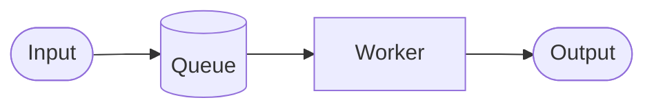

# Writing Blogs for This Site

A guide for writing technical blog posts on this portfolio site. It covers the file format, frontmatter, writing style, structure patterns, code and diagram conventions, and common mistakes to avoid. Everything here is derived from the existing posts and from the design decisions baked into the site.

---

## File Setup

Blog posts live in `content/blogs/` as `.mdx` files. The filename becomes the URL slug.

```
content/blogs/lru-cache-with-ttl.mdx   →   /blogs/lru-cache-with-ttl
content/blogs/go-worker-pool.mdx       →   /blogs/go-worker-pool
```

**Naming convention:** `topic-subtopic-qualifier.mdx`. Lowercase, hyphen-separated, no underscores. For multi-part series, use a numeric suffix: `scaling-reads-01-the-baseline.mdx`.

---

## Frontmatter

Every post must have this frontmatter block at the top:

```yaml
---
title: "Post Title Here"
date: "2026-01-15"
tags: ["Go", "Kafka", "Distributed Systems"]
summary: "One line that describes what the reader will learn."
readTime: 12
draft: false
---
```

**Field rules:**

| Field | Type | Rule |
|---|---|---|
| `title` | string | Descriptive, not clickbait. No question marks. |
| `date` | string | ISO format `YYYY-MM-DD`. Must be a valid date or `posts.ts` will silently sort it to the bottom. |
| `tags` | string[] | 2-5 tags. Use existing tags where possible for consistent filtering. |
| `summary` | string | One sentence. What the reader will learn or build. No exclamation marks. |
| `readTime` | number | Estimate in minutes. Count code blocks as ~1 min each, prose at ~200 wpm. |
| `draft` | boolean | `true` hides the post from listing without deleting it. Use this during writing. |

**Optional fields for series:**

```yaml
series: "Scaling Reads"
seriesOrder: 1
```

These enable the series badge and series navigation component on the post page.

**Type safety note:** `date` is typed as `string | undefined` in `PostMeta`. Always guard with `post.date ?` before using it in components. `readTime` may be `0` if frontmatter is missing; guard with `post.readTime > 0` before rendering.

---

## Post Structure

Most posts follow this sequence of sections. Not every post needs every section, but this order works well for technical depth.

### 1. Opening hook (no heading)

The first 1-3 paragraphs set up the problem before any code. No `##` heading here. The goal is to make the reader understand why this topic matters before you explain how anything works.

Good:
> Fetching data is expensive. A database query that takes 10ms done once is fine. Done 10,000 times per second for the same user record, it is a bottleneck.

Bad:
> In this post we will learn about LRU caches, which are very important data structures used widely in production systems.

The opening should state a real tension or problem, not announce what the post is about.

### 2. Why / The Problem section

One `##` section that frames the design space. What constraints make this problem interesting? What naive approaches fail and why? This section builds intuition before the solution.

### 3. Building blocks, in order

Introduce each component before you use it. If the solution needs a doubly linked list and a hash map, explain each one and why it was chosen before showing the full struct. Each `##` section should introduce exactly one concept.

### 4. Putting It All Together

For posts with a complete implementation, one `##` section that presents the runnable code in a single file. This is where someone who skimmed the post comes to copy the full implementation.

### 5. Testing

For any post with Go code, include a `##` Testing section. Include:
- Core behavior tests
- Edge cases (capacity-one, delete non-existent, double-close, etc.)
- At least one concurrent access test run with `-race`
- The bash command `go test ./... -v -race`

See the LRU cache post for a complete example of test coverage.

### 6. Tradeoffs and Design Decisions

A `##` section comparing the approach taken with alternatives. Use a Mermaid diagram here if the tradeoffs map cleanly to a visual. Keep this honest: state the actual downside of the chosen approach, not just the upsides.

### 7. Summary or Checklist

For long posts (20+ min read), close with either a prose `## Summary` (3-5 short paragraphs covering the key decisions) or a `## Design Checklist` (a code block with checkboxes). The checklist format works well for posts about data structures or system components that readers will implement themselves.

---

## Headings

```
h1   Hero section only. Never use in blog posts.
h2   Section headings in the post body.
h3   Subsection headings within a section. Use sparingly.
```

Do not skip levels. Do not use `h2` inside a card or component that already has an `h2`. Never use `h1` in a blog post.

---

## Code Blocks

Always specify a language tag:

````markdown
```go
// code here
```
````

For code that belongs to a specific file, add a `title=` annotation. This renders a filename label above the block:

````markdown
```go title="cache/cache.go"
package cache
```
````

**Rules for Go code blocks:**
- Include `package` declaration in every standalone snippet
- Include the full `import` block when imports are needed to compile
- Every code block shown as "runnable" must actually compile and run
- Use tabs for indentation (Go standard)
- Do not introduce variables, types, or functions in later sections that were silently assumed in earlier ones. If a function is called before it is defined in the blog, add a one-line forward reference in prose: "We will define `startCleanup` in the [next section](#the-background-cleanup-goroutine)."

---

## Mermaid Diagrams

Mermaid diagrams render inline and open in a fullscreen lightbox when clicked. Use them for:
- Data flow between components
- Before/after comparisons for data structure mutations
- Tradeoff comparisons between approaches

````markdown

````

**Mermaid rules:**
- Use `flowchart LR` (left-right) for data flow, `flowchart TD` (top-down) for hierarchies and tradeoff comparisons
- Use `([...])` for external systems (rounded ends), `[...]` for internal components, `[(...)` for storage/channels
- Subgraphs group related nodes: `subgraph label [...] end`
- Inside a subgraph, always connect nodes with arrows (`A --> B --> C`). Disconnected nodes inside a subgraph render as floating islands
- Keep node labels short. If a label needs two lines use `\n`: `A["Line one\nLine two"]`
- For sequence diagrams of request/response flows, use `sequenceDiagram` instead of `flowchart`

---

## Writing Style

### Tone

Direct and technical. Write like you are explaining something to a colleague who is competent but unfamiliar with this specific topic. No hand-holding, no filler.

### Language rules

- **No em-dashes anywhere.** Use a comma, period, or rephrase. Search for `—` before publishing.
- **No marketing language.** No "robust", "enterprise-grade", "blazing fast", "scalable solution", "best practices".
- **No fake metrics.** Do not invent throughput numbers, latency percentages, or improvement claims unless they come directly from your resume.
- **No passive voice where you can avoid it.** "Get removes the node" not "the node is removed by Get".
- **Short sentences.** If a sentence has more than two clauses, break it up.
- **State the reason before the rule.** "Get moves the node to the front. That is the LRU update: every access marks an entry as most recently used." Not just "every access marks an entry."

### Things not to say

- "In this post, we will..."
- "first principles" (overused; just explain the concept directly)
- "simply", "just", "obviously", "trivially"
- "as we can see"
- "it's worth noting that"

### Comments in code

Write no comments in code unless the WHY is non-obvious: a hidden constraint, a subtle invariant, a workaround for a known bug. Code comments in blog posts are read by beginners — make sure every comment earns its place. Never write a comment that describes what the code does; use clear names instead.

Exception: short inline notes explaining non-obvious behavior are fine in teaching contexts:
```go
head.next = tail  // placeholder sentinel; real entries go between them
```

---

## Content Rules

These rules apply to all content on the site, not just blogs.

- Company name is **Maersk**, not "A.P. Moller - Maersk".
- Job title is **Associate Software Engineer**, not "ASE" or "Senior Engineer".
- Do not invent or exaggerate metrics. If a number is not in the resume, do not publish it.
- The blog is personal. Use "I" sparingly and only for genuine personal context ("At Maersk, our scanner platform..."). Do not use "we" for generic technical statements.

---

## Series Posts

For a multi-part series, add `series` and `seriesOrder` to frontmatter:

```yaml
series: "Scaling Reads"
seriesOrder: 1
```

The site renders a series badge and navigation component automatically. Name the series consistently across all parts. The slug should include the part number: `scaling-reads-01-the-baseline.mdx`, `scaling-reads-02-caching.mdx`.

Write each part so it can stand alone. A reader arriving at part 2 without reading part 1 should understand what problem is being solved, even if the deep context from part 1 is missing.

---

## Common Mistakes

**Using `draft: false` before the post is ready.** Set `draft: true` while writing. The post will not appear in the listing until you change it to `false`.

**Invalid date format.** `date: "November 21, 2026"` will not sort correctly. Use `"2026-11-21"`. If the date string is invalid, `new Date(date).toISOString()` throws a `RangeError`. Always use ISO format.

**Code that does not compile.** Every snippet marked as runnable must compile. The most common omission is a missing `import "time"` when `time.Duration` or `time.Time` is used in a snippet that also imports other packages.

**Em-dashes.** Search the file for `—` before publishing. The site design system does not use them and they break the visual rhythm of the prose.

**Calling a function before defining it in the blog without a forward reference.** Go itself does not care about declaration order, but a reader following along section by section will be confused. Add a one-line note in prose pointing to the section where the function is defined.

**Subgraph nodes with no internal arrows in Mermaid.** Nodes inside a subgraph with no arrows between them render as disconnected islands. Always connect subgraph nodes: `A --> B --> C`.

**Claiming work from Maersk without matching the resume.** Do not add a stat, improvement number, or system capability that is not in the actual resume PDF at `public/resume.pdf`.

---

## Checklist Before Publishing

```
Frontmatter
  [ ] title, date (ISO), tags, summary, readTime, draft: false
  [ ] date is a valid ISO date string (YYYY-MM-DD)
  [ ] readTime is a reasonable estimate

Content
  [ ] No em-dashes anywhere (search for —)
  [ ] No fake metrics or invented numbers
  [ ] All Go code compiles (run it locally before publishing)
  [ ] Every function called is defined somewhere in the post, with a forward reference if needed
  [ ] No passive voice for key technical statements
  [ ] No marketing language

Diagrams
  [ ] Mermaid diagrams render (run dev server and check)
  [ ] Subgraph nodes are connected with arrows
  [ ] Labels are short enough to fit without wrapping

Structure
  [ ] Opening paragraph sets up the problem without a heading
  [ ] Section headings use h2, subsections use h3
  [ ] Tests section present for implementation posts
  [ ] Summary or checklist at the end for posts over 20 min read

Final
  [ ] Ran go test -race ./... locally and it passes
  [ ] Checked on mobile viewport (Tailwind responsive preview)
```
